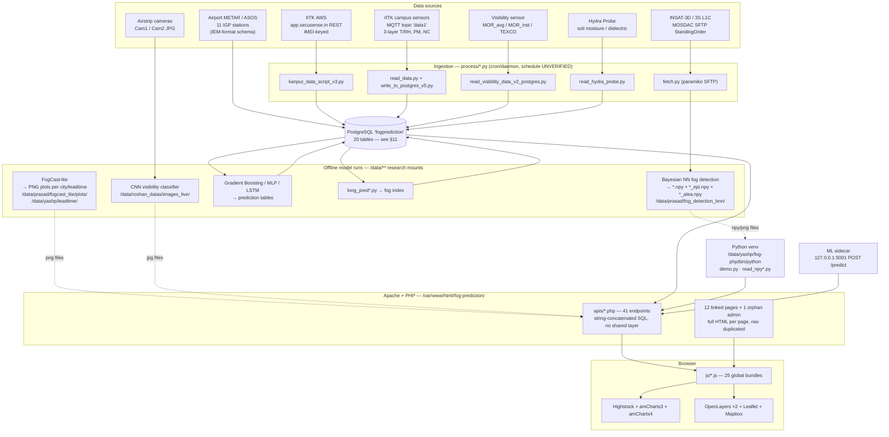
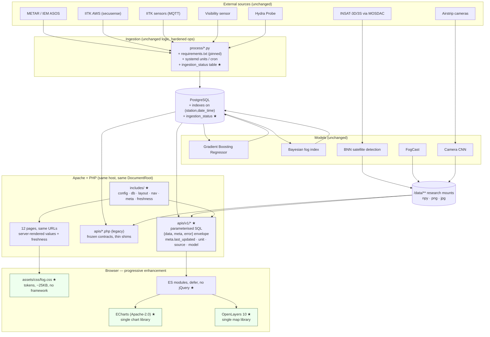

# Fog IITK Website — Complete Audit & Redesign Blueprint

**Audit date:** 2026-09-18 / 2026-09-19
**Live target:** https://fog.iitk.ac.in/fog-prediction/
**Repository root audited:** `/home/love/Downloads/fog_prediction/fog-prediction` (branch `master`, HEAD `68af9ed`)
**Phase:** 0 — Discovery only. No application file was modified. The only file created by this phase is this document.

> **Reading key**
> `VERIFIED` — observed directly in the repository or by HTTP request against the live host.
> `UNVERIFIED` — plausible from evidence but not directly confirmed.
> `NEEDS CONFIRMATION` — requires an answer from the project team or shell access to the production host.
> All credentials, tokens and passwords found during the audit are **redacted** here as `<REDACTED>`. Their *locations* are reported because they must be rotated.

---

## 1. Executive Summary

Fog IITK is a working scientific instrument dressed in a 2020-era Bootstrap template. The science is genuinely strong and peer-reviewed — the site is the operational front end for work published in *Current Science*, *QJRMS*, *Urban Climate*, *Remote Sensing in Earth Systems Sciences*, IGARSS and CODS-COMAD. The FogCast paper (QJRMS, 2026) cites `fogcast_lite_forecast.php` **by URL** as the public access point for its real-time forecasts. The site is therefore a cited research artefact, not just a webpage.

The audit found five things that matter more than styling:

1. **The site is quietly stale, and it does not say so.** As of 2026-09-18: airport METAR observations for 10 of 11 stations last updated **2026-07-09 (71 days)**; the long-range fog-index table last updated **2026-06-27 (83 days)**; the satellite BNN spatial product last updated **06 JAN 2026 (~8 months)**; the live-model endpoint `apis/predict_live.php` returns `{"error":"Three recent observations are not available"}`. Every page renders these as if current. For a forecasting service, silent staleness is the most damaging possible defect — worse than an ugly chart. *(§13.6, §21.1)*
2. **Serious security exposure.** The entire `.git` directory is publicly readable (`/.git/config`, `/.git/index`, `/.git/HEAD` all return 200), Python source with third-party credentials is served as `text/x-python`, directory listings are on for `process/`, `assets/`, `all_datasets/`, `extra/`, a 266-line error log of real email addresses is world-readable, and the feedback inbox (`new_messages.php`, names + emails + phone numbers) is gated only by `?isadmmin=777`. PostgreSQL credentials are hardcoded in ~30 PHP files and SQL is string-concatenated from `$_GET`/`$_POST` throughout. *(§26)*
3. **The dependency stack is duplicated four times over.** The homepage ships amCharts 3 *and* amCharts 4 *and* Highstock; `spatial_fog.php` ships OpenLayers 6.4.3 *and* OpenLayers 6.9.0 *and* Leaflet 1.7.1 *and* Mapbox GL *and* Mapbox.js, plus two jQuery versions on one page. It also still references **`cdn.polyfill.io`**, the domain compromised in the June 2024 supply-chain attack. *(§25, §26.3, §27)*
4. **The information architecture hides the product.** The homepage's largest element is the sentence "WELCOME TO IIT KANPUR REAL-TIME FOG PREDICTION WEBSITE."; the current fog state for the selected city appears below it, and the model selector is entirely commented out in the shipped HTML. Eleven navbar destinations are presented as a flat list of features rather than as *observation → forecast → evidence*. *(§21, §31)*
5. **A partial, uncommitted redesign already exists locally and should not be shipped.** The working tree contains a Tailwind "bento grid" rewrite of `index.php` with a floating pill navbar, indigo accents, `backdrop-blur`, `animate-ping`, and copy reading "IIT Kanpur Fog Intelligence - Premium", "Machine Learning Intelligence Output", "Live telemetry data & predictive analytics". This is exactly the generic AI aesthetic the brief forbids, and it is not deployed. *(§22.3)*

**Recommended direction:** keep PHP, keep every existing URL, harden and consolidate the data layer into a real JSON API, and rebuild the presentation layer in place against a single design system with one chart library and one map library. React/Next.js are **not** justified by anything found in this codebase or its hosting. The committed design direction is *Observatory Log* — an instrument-and-record aesthetic built on the serif the site already uses, with data currency ("last observed N minutes ago, source X") promoted to a first-class, always-visible element. *(§29, §35)*

---

## 2. Scope

### In scope
- Full repository forensic audit: PHP, HTML, CSS, JS, Python, CSV, JSON, GeoJSON, HDF5, config, `.htaccess`.
- Full live-site crawl of https://fog.iitk.ac.in/fog-prediction/ including orphaned documents and API endpoints.
- Data inventory and provenance tracing from sensor/satellite/METAR source to rendered pixel.
- Scientific-content audit against the project's own published literature.
- UX, visual, accessibility, responsive, performance, SEO and security audits.
- Technology evaluation (PHP vs React vs Next.js vs hybrid) against *actual* hosting evidence.
- Design system, animation system, data-visualisation system and migration plan.

### Out of scope for this phase
- Any modification to `index.php`, other PHP pages, backend logic, forecasting algorithms, database queries, APIs, prediction outputs or production configuration.
- Any framework migration.
- Any deletion or renaming of pages or URLs.

### Method and evidence base
| Activity | Evidence |
|---|---|
| Repository census | `find`/`git status` over 15,000+ files; 197 PHP, 2,194 JS, 1,424 HTML, 120 Python, 157+ CSV |
| Live crawl | 36 candidate URLs probed; full internal link graph extracted from 13 rendered documents with HTML comments stripped |
| API behaviour | 9 live read-only endpoint smoke tests + freshness probes across 5 stations and 5 data feeds |
| Asset weight | 13 production bundles measured over the wire, compressed and uncompressed |
| Scientific verification | 8 project publications parsed from `apis/publications.json`; cross-checked against Current Science, QJRMS, Springer, Elsevier, IEEE, ACM |

### Limits of this audit
- No shell access to the production host. PHP version, cron schedules, Apache vhost config, systemd units and the `/data/**` research mounts are inferred from code paths only.
- The PostgreSQL database was not queried directly; schema is reconstructed from SQL literals in PHP/Python. A 788 MB dump (`fogprediction database.dump`) exists locally but was not restored or parsed.
- Visual judgements were made from rendered HTML/CSS and structural analysis, not from screenshots of every page in every breakpoint. Findings marked *(inferred)* where that distinction matters.

---

## 3. Skill / Tooling Availability

All three required design resources are **installed and verified available**.

| Resource | Command / method | Status | Where it landed |
|---|---|---|---|
| Emil Kowalski skill | `npx skills add emilkowalski/skill` | ✅ **Installed & verified** | `.agents/skills/{animate, animate-expo, animation-vocabulary, apple-design, ask-sonner, emil-design-eng, find-animation-opportunities, improve-animations, mobile-native, pick-ui-library, prototype, review-animations, write-swift}` — symlinked into `.claude/skills/` |
| Taste skill | `npx skills add Leonxlnx/taste-skill` | ✅ **Installed & verified** | `.agents/skills/{design-taste-frontend, design-taste-frontend-v1, brandkit, high-end-visual-design, minimalist-ui, industrial-brutalist-ui, gpt-taste, image-to-code, imagegen-frontend-web, imagegen-frontend-mobile, redesign-existing-projects, stitch-design-taste, full-output-enforcement, uipro}` — symlinked into `.claude/skills/` |
| Avoid AI Design | `git clone https://github.com/funboy322/avoid-ai-design` (repo ships an agentskills.io-format `SKILL.md`; there is no `npx skills add` published for it) | ✅ **Cloned & read** | Scratchpad clone; `SKILL.md`, `README.md`, `docs/`, `references/`, `examples/` present and read |

**Verification performed:** `ls -la .claude/skills` confirms 27 live symlinks resolving into `.agents/skills/`; `skills-lock.json` records source repo + content hash per skill; `avoid-ai-design/SKILL.md` was read in full (v0.2.0, MIT).

**Nothing failed to install.** Two notes for the implementation phase:

- `.agents/` and `.claude/` are currently **untracked** in git. Decide deliberately whether to commit them (reproducible tooling for the next student) or add them to `.gitignore`.
- The taste-skill bundle installs 14 skills including several mutually exclusive aesthetic directions (`industrial-brutalist-ui`, `minimalist-ui`, `high-end-visual-design`). Per the avoid-ai-design guardrail on second-order defaults, **do not invoke more than one aesthetic skill** — the committed direction is fixed in §35 and the skills are to be used for craft, not for choosing the look.

**How each resource is applied in this blueprint:**
- *Emil Kowalski* → §40 Animation System (purpose, duration, easing, triggers, reduced-motion) and interaction detail in §39.
- *Taste skill* → §36–§39 (typographic scale, spacing rhythm, composition, restraint).
- *Avoid AI Design* → §22.3 (P0/P1/P2 audit of the existing local rewrite) and §35's explicit "commit to one direction" requirement and anti-pattern ban list.

---

## 4. Repository Overview

### 4.1 Top-level shape

```
fog-prediction/                    ← git root, == Apache DocumentRoot /var/www/html/fog-prediction/
├── index.php  index2.php  index3.php        homepages (current + 2 legacy)
├── sensordata.php  sensordata3.php          IITK station data
├── spatial_fog.php  spatial_fog.html        satellite spatial fog (+ 4 more legacy variants)
├── spatial.html  spatial1.html  spatial2.html
├── fogcast_lite_forecast.php                FogCast medium-range forecast
├── camera_based_visibility_detection.php    CNN camera classifier
├── comparedata.php                          multi-station comparison
├── short_term_forecast_comp.php             0.5–3 h forecast vs observed
├── long_pred_comp.php  long_pred_comp.html  6 h–5 d fog-index comparison
├── long_term.php  LongTerm.php  long_term_pred.php  long_tem_test.php
├── about.php  publication.php  contact_us.php
├── new_messages.php                         feedback inbox (admin; see §26)
├── navbar.php                               shared nav include (LOCAL ONLY — not on live)
├── apis/            41 PHP endpoints + 5 Python + publications.json + station CSVs
├── js/              25 page bundles (main.js … main4.js, sensordata*.js, spatial*.js …)
├── css/main.css     969 bytes — effectively unused
├── assets/          Argon Design System theme, amCharts 4 ("chart-library"), fonts, imgs, pdfs
├── amcharts4/       vendored amCharts 4 + its full examples tree (~4,000 files)
├── geodata/         indiaHigh.js, india2019High.js, shapefiles, GeoJSON, KML
├── process/         2,713 files — ingestion scripts + raw daily sensor .txt archive
├── extra/           legacy JS/HTML scratch copies
├── all_datasets/    ML train/val/test CSVs (long_term, short_term)
├── fog_index/ long_term/   duplicate page copies
├── sample_fog_images/      satellite/camera samples
└── fog-prediction/         ← nested near-duplicate of the whole site, 3 levels deep
```

### 4.2 File census (excluding `.git`)

| Type | Count | Note |
|---|---|---|
| `.txt` | 7,680 | 2,585 are daily sensor archives in `process/` (`YYYY-MM-DD.txt`, `_hydra`, `_vis`) |
| `.js` | 2,194 | ~2,150 belong to the vendored `amcharts4/examples/` tree |
| `.html` | 1,424 | likewise dominated by amCharts examples |
| `.css` / `.scss` / `.map` | 889 / 268 / 899 | Argon theme sources shipped alongside compiled CSS |
| `.md` | 775 | vendor docs |
| `.php` | 197 | **~60 are project code**; the rest are duplicates in nested trees |
| `.json` | 372 | incl. `apis/publications.json`, GeoJSON |
| `.csv` | 157+ | station tables, ML datasets, sensor exports |
| `.py` | 120 | ingestion, ML glue, mail |
| `.h5` | 4 | INSAT-3D L1C HDF5 granules (21 MB each, two identical copies at root) |
| `.mp4` | 4 | fog time-lapse used on `about.php` (4.7 MB, two copies) |

### 4.3 Repository health problems

| Problem | Evidence | Impact |
|---|---|---|
| **Recursive self-copy** | `fog-prediction/fog-prediction/fog-prediction/` — the site contains itself 3 levels deep, each with its own `.htaccess` | Bloats repo, confuses search, risks editing the wrong file |
| **788 MB DB dump committed to the working tree** | `fogprediction database.dump` (untracked but present); returns `000` on live (too large / blocked) | Repo is unclonable at normal speeds; a credential-bearing artefact sits in the deploy directory |
| **Vendored library examples** | `amcharts4/examples/` ≈ 4,000 files incl. photos of *Friends* cast and car-brand logos | ~80% of repo file count is dead weight |
| **Binary assets never optimised** | `logo.png` 4.16 MB, `logo_icon.png` 4.36 MB at repo root | Unused at these sizes; the site actually serves `assets/img/fps1.png` |
| **Working tree massively diverged** | `git status`: **241 deleted**, **143 untracked**, **21 modified** tracked files | The repository no longer describes what is deployed. See §4.4 |
| **No `.gitignore` discipline** | `.htaccess`, `README.md`, `.agents/`, `.claude/`, dumps, `.h5`, `.mp4` all untracked | Impossible to tell intentional from accidental |
| **Two git remotes, neither authoritative** | `.git/config`: `origin`→`hydroinfo-prasad/FogPrediction.git`, `FogPrediction`→`chaman199/fog.git` | `NEEDS CONFIRMATION`: which is canonical? |
| **Only 2 commits in history** | `b92a72d first commit`, `68af9ed some minor changes` | No usable history; no blame, no rollback |

### 4.4 Local working tree vs live server — they are **not** the same site

This is the single most important context for the redesign.

| | Live (`fog.iitk.ac.in`) | Local working tree |
|---|---|---|
| Homepage shell | Bootstrap 4.3.1 + Argon Design System, `Libre Baskerville` serif body | Tailwind (Play CDN), dark-by-default, sidebar + "bento grid" |
| Navbar | Argon `navbar-expand-lg`, inline in every page | Extracted to `navbar.php`, floating translucent pill, indigo, `backdrop-blur-xl` |
| `navbar.php` | returns **0 bytes** — file does not exist on live | 19,978 bytes, included by every local page |
| `apis/location.php` | **404** | exists locally (520 bytes) |
| `apis/predict_live.php` | exists, returns an error | exists locally |
| Homepage copy | "WELCOME TO IIT KANPUR REAL-TIME FOG PREDICTION WEBSITE." | "IIT Kanpur Fog Intelligence - Premium" / "Machine Learning Intelligence Output" |

**Implication:** the live site is the source of truth for *behaviour and URLs*; the local tree is the source of truth for *the most recent code*, but its presentation layer is a half-finished AI-styled rewrite that must not be deployed. The redesign starts from the live behaviour, not from the local `index.php`.

---

## 5. Current Technology Stack

### 5.1 Server (VERIFIED by response headers and code paths)

| Layer | Value | Evidence |
|---|---|---|
| Web server | **Apache** (version suppressed) | `Server: Apache` |
| Protocol | **HTTP/1.1 only** — no HTTP/2 | `curl -w '%{http_version}'` → `1.1` |
| TLS | HTTPS available and used | `scheme=https`, `ssl_verify_result=0` |
| Compression | **gzip enabled** for JS/CSS | `Content-Encoding: gzip`; argon CSS 400 KB → 56 KB |
| Caching | **No `Cache-Control`/`ETag` on HTML**; PHP sends `no-store, no-cache, must-revalidate` | Response headers on `index.php` |
| Language | PHP with `pgsql` ext (`pg_connect`, `pg_query_params`) | ubiquitous |
| PHP version | **≥ 7.4** (`declare(strict_types=1)`, `??`, `fn() =>`). No PHP-8-only syntax (`match`, `enum`, named args) found. | `apis/predict_live.php`, `apis/files.php` — `UNVERIFIED` exact version; `X-Powered-By` is suppressed |
| Sessions | PHP sessions, cookie `PHPSESSID` | `Set-Cookie` on every page |
| Database | **PostgreSQL** on `localhost:5432`, db `fogprediction`, user `chaman` | ~30 files |
| DocumentRoot | `/var/www/html/fog-prediction/` | hardcoded `copy()` targets in `apis/files.php`, `apis/cam_images.php` |
| Python runtime | venv at `/data/yashp/fog-php/bin/python` | `apis/city_handler.php`, `files1.php`, `files_batch.php`, `getloc.php` |
| Research mounts | `/data/prasad/**`, `/data/yashp/**`, `/data/roshan_datas/**`, `/home/prasad/` | `apis/*.php`, `apis/read_npy.py` |
| Sidecar ML service | HTTP service on `127.0.0.1:5001` exposing `POST /predict` | `apis/predict_live.php` |
| Transport for sensors | MQTT (`paho.mqtt`), topic `data1` | `process/read_data.py` |
| **Node.js** | **No evidence anywhere.** No `package.json`, no `node_modules`, no build output, no bundler config, no CI. | repo-wide search |

### 5.2 Client libraries actually shipped

| Library | Version(s) | Delivery | Used by |
|---|---|---|---|
| jQuery | **3.2.1** (local) + **3.1.1** (CDN) + **3.7.1** (CDN) | mixed | all pages; ≥2 versions co-loaded on `sensordata.php`, `spatial_fog.php`, `fogcast_lite_forecast.php`, `long_term.php` |
| jQuery UI | 1.12.1 | googleapis CDN | autocomplete on location input |
| Bootstrap | **4.3.1** (local) + 3.4.1 CSS (maxcdn, some legacy pages) | mixed | layout/grid |
| Argon Design System | 1.2.0 | local, **400 KB CSS** (56 KB gzip) | entire visual theme |
| Highcharts / Highstock | **9.1.2** (pinned) **and** `stock/highstock.js` (**unpinned = always latest**) | code.highcharts.com | all time-series charts |
| amCharts 4 | vendored as `assets/chart-library/{core,charts}.js` (1.02 MB + 145 KB) | local | loaded on every page |
| amCharts 4 map | `amcharts4/ammap.js` (168 KB) | local | homepage, comparedata |
| amCharts 3 | `lib/3/maps/js/indiaLow.js` | amcharts.com CDN | homepage, comparedata, legacy |
| India geodata | `indiaHigh.js` (177 KB) + `india2019High.js` (187 KB) | local | homepage |
| OpenLayers | **6.4.3** (openlayers.org) **and** **6.9.0** (jsDelivr `@master`) | CDN | all spatial pages |
| ol-layerswitcher | `raw.githack.com/...@master` (**unpinned**) + unpkg 3.8.3 | CDN | spatial pages |
| Leaflet | 1.7.1 | unpkg | spatial pages |
| Mapbox GL JS | 2.14.1 | api.mapbox.com | spatial pages |
| Mapbox.js | 3.3.1 | api.mapbox.com | spatial pages |
| proj4js | 2.7.5 | cdnjs | spatial reprojection |
| chroma-js | 2.1.0 | cdnjs | colour scales |
| shp2geojson | `gipong.github.io` (**unpinned, personal GH Pages**) | CDN | shapefile loading |
| **polyfill.io** | `cdn.polyfill.io/v2/polyfill.min.js` | CDN | **spatial_fog.php + 7 legacy pages — see §26.3** |
| zipcelx | jsDelivr `gh/egeriis/zipcelx` (**unpinned**) | CDN | XLSX export |
| Font Awesome | **5.0.6** (2018) + 4.7.0 | CDN | icons |
| moment.js | bundled | local | date handling |
| Misc Argon plugins | nouislider, perfect-scrollbar, bootstrap-datepicker, datetimepicker, bootstrap-switch, headroom | local | chrome |
| Tailwind (Play CDN) | latest | **local tree only, not live** | the uncommitted rewrite |

**Four charting/mapping systems and two-to-three jQuery copies are loaded concurrently.** No bundler, no tree-shaking, no module system — every script is a global `<script>` tag.

---

## 6. Current Architecture



### 6.1 Architectural characteristics

- **No shared PHP layer.** There is no router, no template engine, no config file, no DB abstraction. Every page is a standalone script that opens its own `pg_connect` with an inline password and emits a complete HTML document. The navigation markup is copy-pasted into all 13 documents.
- **Two parallel data paths.** Tabular data comes from PostgreSQL via `apis/*.php`. Spatial and camera products bypass the database entirely and are read straight off research filesystem mounts (`scandir`, `glob`, `file_get_contents`), then base64-inlined into JSON responses.
- **Three response formats in one API directory.** Some endpoints emit proper JSON (`json_encode`), some emit hand-built JSON strings by string concatenation (`apis/database.php`, `visdata.php`, `sensordata3.php`), and two emit **JavaScript source** with a `var files = [...]` prefix (`apis/files.php`, `apis/cam_images.php`) intended to be loaded as a `<script>`.
- **Side effects in GET handlers.** `apis/files.php` and `apis/cam_images.php` **copy files into the web root** on every request. `index.php` performs database INSERT/UPDATE for visitor tracking on page render.
- **Shell-out coupling.** `apis/city_handler.php`, `files1.php`, `files_batch.php`, `getloc.php` and `contact_us.php` invoke Python via `shell_exec`/`exec`, tying request latency to interpreter startup and NFS read speed.

---

## 7. Live Website Overview

**Entry point:** `https://fog.iitk.ac.in/` is a bare redirect page titled "Fog Prediction Activities at IIT Kanpur" with no navigation of its own. The real application lives entirely under `/fog-prediction/`.

**Shell:** every page is an independent HTML document with the same inlined Argon navbar, a `Libre Baskerville` serif body font, and a one-line footer "© Fog Prediction , IIT Kanpur. All rights reserved." The homepage additionally renders "Total Visitors: 73783".

**Global controls in the navbar:**
- A location autocomplete (`#myInput`) + "Go" button calling `loaddata(4)` — present in the navbar on **every** page, but only functional on the homepage.
- A "Choose Model" dropdown listing *Gradient Boosting Multiclassifier*, *Multilayer Perceptron (MLP)*, *Gradient Boosting 1*, *Gradient Boosting Regressor*, *Model 5* — **entirely wrapped in HTML comments in the shipped markup**, so no model can be chosen. Two of the five were already disabled with `pointer-events: none` before being commented out.

**Freshness:** no page displays a "last updated" timestamp for its underlying data. §13.6 quantifies how far behind that data actually is.

---

## 8. Exact Page Inventory

### 8.1 Counting method

A **user-facing page** is a document that (a) returns HTTP 200 from the live host, (b) renders a complete HTML UI, and (c) is not an AJAX endpoint, include fragment or asset. Reachability was established by extracting every `href`/`action` from all 13 rendered documents **after stripping HTML comments** (the shipped markup contains large commented-out nav blocks that would otherwise inflate the count).

The internal link graph is **closed**: every page links to the same 12 destinations and nothing else.

### 8.2 The exact numbers

| Category | Count |
|---|---|
| **A. Primary user-facing pages (navbar-reachable)** | **12** |
| B. Orphaned pages — live, HTTP 200, render a UI, **not linked from anywhere** | 19 |
| C. Live admin page, not linked, publicly reachable | 1 (`new_messages.php`) |
| **Total documents on live returning 200 and rendering a UI** | **32** |
| D. Include fragments (0 bytes standalone) | 2 (`navbar.php` — local only; `asach.php` — empty) |
| E. Broken internal link | 1 (`about.html` → 404, linked from 8 pages) |
| F. API/AJAX endpoint files in `apis/` | 41 (39 non-empty, 2 empty) |
| G. API endpoints referenced by shipped frontend code | 28 (+1 dead reference to non-existent `apis/sensordata1.php`) |
| H. Downloadable dataset/document assets | 5 (`assets/pdfs/Fog_Prediction.pdf`, 4 ML CSVs in `all_datasets/`) |

> **Headline: 12 primary user-facing pages.** 13 if the unlinked admin inbox is counted as user-facing. 32 documents are live and publicly renderable in total.

### 8.3 Primary page inventory (A)

| # | URL (relative to `/fog-prediction/`) | File | Page name (as titled) | Category | Navbar | Data driven | Interactive | Purpose | Dependencies | Status |
|---|---|---|---|---|---|---|---|---|---|---|
| 1 | `index.php` | `index.php` | Fog Prediction | Live / Home | ✅ top | ✅ | ✅ | Current + short-term visibility for one selected station; India map; met charts | `apis/{map,position,database,database1,newpred,findlast}.php`; `js/main2.js`; Highstock; amCharts 3+4; indiaHigh geodata | **Live, data 71 d stale** |
| 2 | `sensordata.php` | `sensordata.php` | IIT Kanpur Weather Station | Observations | ✅ top | ✅ | ✅ | All IITK campus instruments: visibility, 3-layer T/RH, PM/NC, soil probe, AWS | `apis/{sensordata,sensordata3,visdata,iitdata,download}.php`; `js/sensordata.js` (114 KB) | **Live, 9–12 d stale** |
| 3 | `spatial_fog.php` | `spatial_fog.php` | Map | Spatial | ✅ dropdown | ✅ | ✅ | Satellite BNN fog probability + epistemic/aleatoric uncertainty over a map; per-city lookup | `apis/{files_batch,files1,city_handler,findloc}.php` → `read_npy*.py`; OpenLayers ×2 + Leaflet + Mapbox | **Live, product ~8 mo stale** |
| 4 | `fogcast_lite_forecast.php` | `fogcast_lite_forecast.php` | Fogcast-lite Forecast | Forecast / Spatial | ✅ dropdown | ✅ | ✅ | FogCast medium-range fog forecast, 6 h–10 d lead time, 4 layers | `apis/{spatial_prediction,spatial_prediction1}.php` (PNG from `/data/**`) | **Live — cited by QJRMS paper** |
| 5 | `camera_based_visibility_detection.php` | same | Camera-Based Visibility Detection | Observations / Model | ✅ top | ✅ | ✅ | CNN visibility classifier results from 2 airstrip cameras; correct vs misclassified galleries | `apis/fetch_images.php` → `/data/roshan_datas/**` | Live |
| 6 | `comparedata.php` | `comparedata.php` | Compare Locations Data | Compare | ✅ dropdown | ✅ | ✅ | Compare up to 4 stations: visibility, temp, humidity, wind | `apis/{compare2,map}.php`; `js/compare.js`; amCharts | Live |
| 7 | `short_term_forecast_comp.php` | same | Short-term Forecast Comparison | Compare / Model | ✅ dropdown | ✅ | ✅ | Observed vs predicted visibility at 0.5–3 h lead, Gradient Boosting Regressor, RMSE | `apis/{curvspred,lstm,findlast,map}.php`; `js/curvspred.js` (103 KB) | Live |
| 8 | `long_pred_comp.php` | same | Long-Term Forecast Comparison | Compare / Model | ✅ dropdown | ✅ | ✅ | Observed vs predicted **fog index** at 6 h / 1 d / 3 d / 5 d lead | `apis/long_pred_comp.php`; `js/long_pred_comp{,_vis}.js` | **Live, 83 d stale** |
| 9 | `long_term.php` | `long_term.php` | Long-term Forecast | Forecast | ✅ top | ✅ | ✅ | Fog-index long-range forecast, 6 h → 5 d horizon tiles + time series | `apis/{fog_index,long_term_pred}.php`; histogram-bellcurve module | **Live, 83 d stale** |
| 10 | `about.php` | `about.php` | About | Research / Team | ✅ dropdown | ❌ | ❌ | Motivation, fog time-lapse video, 4 current members, 3 mentors, 10 past members | static; 4.7 MB MP4 | Live |
| 11 | `publication.php` | `publication.php` | Paper Publication | Research | ✅ dropdown | ✅ (JSON) | ✅ (accordion) | 8 peer-reviewed publications with abstracts, authors, keywords, DOIs | `apis/publications.json` | Live |
| 12 | `contact_us.php` | `contact_us.php` | Contact Us | About | ✅ dropdown | ✅ (write) | ✅ (form) | Feedback form → `public.feedback` + email via Python | inline POST handler; `process/send_feedback_mail.py` | **Live — SQLi, see §26.2** |

### 8.4 Orphaned / legacy pages (B) — live but unlinked

All return HTTP 200. None is reachable from any navigation.

| URL | Bytes | Title | Apparent former role | Recommendation |
|---|---|---|---|---|
| `index2.php` | 20,378 | Fog Prediction | previous homepage | Remove after redirect audit |
| `index3.php` | 19,286 | Fog Prediction | older homepage | Remove |
| `sensordata3.php` | 19,571 | IIT Kanpur Page | earlier station page | Remove |
| `spatial.html` | 50,049 | Spatial Fog Detection | earlier spatial page | Remove (loads `polyfill.io`) |
| `spatial1.html` | 36,416 | Map | spatial iteration | Remove (loads `polyfill.io`) |
| `spatial2.html` | 23,652 | Map | spatial iteration | Remove (loads `polyfill.io`) |
| `spatial_fog.html` | 40,350 | Map | static twin of `spatial_fog.php` | Remove (loads `polyfill.io`) |
| `long_pred_comp.html` | 10,194 | Long-Term Forecast Comparison | static twin | Remove |
| `LongTerm.php` | 22,917 | Fog Prediction | long-term iteration | Remove |
| `long_term_pred.php` | 17,190 | IIT Kanpur Page | long-term iteration | Remove |
| `long_tem_test.php` | 28,061 | Fog Prediction | test page in production | **Remove — test artefact** |
| `locate1.html` | 26,020 | Past Prediction | historical prediction viewer | Evaluate: does anything replace it? |
| `locate2.html` | 29,826 | Map | map iteration | Remove |
| `map_measure_info.html` | 21,168 | OpenLayers example | **vendor demo left in production** | Remove |
| `moremodel.html` | 19,250 | More Models | multi-model comparison — **indexed by search engines** | Evaluate before removing (§46) |
| `tweet.html` | 20,978 | Past Prediction | Twitter/MongoDB experiment | Remove |
| `approach.html` | 5,875 | (none) | methodology text | **Mine for content** before removing — §19 |
| `iitkstation.html` | 6,021 | Fog Prediction | station description | **Mine for content** before removing |
| `map_image.php` | 1,125 | (none) | map image fragment | Remove |

### 8.5 Live admin page (C)

| URL | Bytes | Auth | Exposes |
|---|---|---|---|
| `new_messages.php` | 189,015 | `apis/start_admin.php` — session flag set by `?isadmmin=777` | Full `public.feedback` table: Date/Time, First Name, Last Name, **Email**, Organisation, Feedback, **Number** |

### 8.6 API / AJAX endpoints (F, G) — `apis/`

**Referenced by shipped frontend code (28):**

| Endpoint | Params | Source | Returns | Consumers |
|---|---|---|---|---|
| `map.php` | — | `public.location` ⋈ `validity` (CSV fallback) | `[[name, lat, lon, station_id], …]` — **11 stations** | 12 JS bundles |
| `position.php` | `cityid` | `location.lat_lon` / CSV | `{lat, lng}` | 8 bundles |
| `findloc.php` | `address` | `process/demo.py` geocode | lat/lon | spatial |
| `findlast.php` | `station` | `max(date_time)` | `[epoch_ms]` | curvspred |
| `database.php` | `station` | `meteorological_data` + `rainfall_data` | 2 nested arrays | 8 bundles |
| `database1.php` | `station`, `interval` \| `start_date`+`end_date` | same, windowed | **⚠ emits literal `Array` before JSON** | main3/main4 |
| `compare2.php` | `station` | `aws_table` \| `meteorological_data` | rows | compare.js |
| `iitdata.php` | `select`, `interval`\|dates | `visdata` | rows | 5 bundles |
| `visdata.php` | `select` | `visdata` full history | `[[ts, MOR_avg, MOR_inst, TEXCO], …]` | sensordata |
| `sensordata.php` | `select`, `interval`\|dates | `aws_table` (1), `data` (2) | JSON | sensordata |
| `sensordata2.php` | — | `metdata` full history | array | sensordata, test |
| `sensordata3.php` | `select` 0/1/2/4 | `visdata`/`metdata`/`hydraprobe`/`aws_table` | **⚠ `select=4` returns invalid JSON** | 4 bundles |
| `newpred.php` | `status`, `station`, `model`, `stime` | `three_hour_fog_prediction` \| `non_winter_month_vis_prediction` \| `fog_prediction_iitk` | prediction series | 6 bundles |
| `predict.php` | `stime`, `station`, `model` | `three_hour_fog_prediction` | `prediction_time, visibility_km, fog_type` | temp, map |
| `curvspred.php` | `status` 0–4, `station`, `stime`, `etime`, `modelno` | obs vs prediction tables | paired series | curvspred |
| `lstm.php` | `status`, `station`, times | `meteorological_data` / `lstm_vis` | vis1…vis12 | curvspred |
| `fog_index.php` | `station`, `interval`\|dates | `long_prediction1` | `[[series],[latest 21 horizons]]` | fog_index, long_tem_test |
| `long_term_pred.php` | — | `long_prediction1` | as above | long_term_pred |
| `long_pred_comp.php` | `station` | `long_prediction1` selected horizons | comparison series | long_pred_comp |
| `spatial_prediction.php` | `cityname` | PNG `scandir` `/data/prasad/fogcast_lite/plots/feb_2025/**` | `[[date, leadtime, type, base64PNG], …]` | fogcast page |
| `spatial_prediction1.php` | `startdate`, `leadtime` | PNG `scandir` `/data/yashp/leadtime/<lt>` | same | fogcast page |
| `files.php` | — | `glob` `/data/prasad/fog_detection_bnn/small_png/*.png` | **JS source** `var files = [...]` + copies files into web root | spatial |
| `files1.php` | POST city/lat/lon/date | `.npy` via `read_npy.py` | image + per-station probabilities | `js/spatial.js` |
| `files_batch.php` | POST batched | `read_npy_batch.py` | batched results | `js/spatial_enhance.js` |
| `city_handler.php` | POST `city`\|`lat`+`lon` | `demo.py` geocode → raster row/col | `{success, city, lat, lon, row, col}` | `js/spatial_enhance.js` |
| `fetch_images.php` | POST `method`, `cam`, `date` | `/data/roshan_datas/**` JPGs | base64 images + labels | camera page |
| `download.php` | `station`, `sdate`, `edate` | `SELECT *` from `meteorological_data` | `.xls` attachment (filename `your_desired_name.xls`) | sensordata, map |
| `start_admin.php` | `isadmmin` | session | sets `$admin` | **included by all 13 pages** |

**Present but unreferenced (11):** `cam_images.php`, `getloc.php`, `gettweet.php`, `location.php` (404 on live), `long_pred_comp1.php`, `newt.php`, `predict1.php`, `predict6.php`, `predict_live.php`, `value.php`, `index.php` (redirect stub).
**Empty (2):** `checkpred.php`, `contact.php`.
**Backup file in production dir (1):** `database.php.backup-20260817`.
**Dead reference (1):** `js/test.js` calls `apis/sensordata1.php`, which does not exist.

---

## 9. Current Navigation / Information Architecture

### 9.1 Live navigation tree (VERIFIED, comments stripped)

```
Fog Prediction (logo → /fog-prediction/)
│
├── [location autocomplete + "Go"]        ← on every page, functional only on Home
├── [Choose Model ▾]                      ← ENTIRELY COMMENTED OUT in shipped HTML
│     · Gradient Boosting Multiclassifier   (modelno=1)
│     · Multilayer Perceptron (MLP)         (modelno=2, was pointer-events:none)
│     · Gradient Boosting 1                 (modelno=3, was pointer-events:none)
│     · Gradient Boosting Regressor         (modelno=4)
│     · Model 5                             (modelno=5)
│
├── Home                                   → index.php   (marked hidden in markup)
├── IIT Kanpur Weather Station              → sensordata.php
├── Spatial Fog Detection ▾
│     ├── Real-Time Spatial Fog             → spatial_fog.php
│     └── Forecast Spatial Fog              → fogcast_lite_forecast.php
├── Camera-Based Fog Detection              → camera_based_visibility_detection.php
├── Compare Results ▾
│     ├── Real-Time Data Comparison         → comparedata.php
│     ├── Short-Term Forecast Comparison    → short_term_forecast_comp.php
│     └── Long-Term Forecast Comparison     → long_pred_comp.php
├── Long-Term Forecast                      → long_term.php
└── About ▾
      ├── About Us                          → about.php
      ├── Paper Publications                → publication.php
      └── Contact Us                        → contact_us.php
```

Footer: a single copyright line. No secondary navigation, no sitemap, no breadcrumbs.

### 9.2 IA defects

| # | Defect | Evidence | Consequence |
|---|---|---|---|
| IA-1 | **Organised by technique, not by question.** "Spatial Fog Detection", "Camera-Based Fog Detection", "Compare Results" describe *how the team works*, not *what a visitor wants to know*. | nav labels | A traveller asking "will Delhi be fogged in tomorrow?" has no obvious entry |
| IA-2 | **Observation and forecast are interleaved arbitrarily.** `spatial_fog.php` (observation) and `fogcast_lite_forecast.php` (forecast) sit in the same dropdown; `long_term.php` (forecast) is a sibling of `Compare Results`. | nav tree | Users cannot tell what is measured from what is predicted — the most important distinction on the site |
| IA-3 | **Three "comparison" pages, indistinguishable by name.** "Real-Time Data Comparison" / "Short-Term Forecast Comparison" / "Long-Term Forecast Comparison" differ by *lead time* and *target variable* (visibility vs fog index), which the labels never say. | nav tree | Requires trial and error |
| IA-4 | **Dead global control shipped.** The model selector is commented out yet its container and `#model-choose` button id persist in every page's DOM. | `live/index.php` | Dead weight; suggests the site once had capability it no longer exposes |
| IA-5 | **`Home` is `hidden`.** The markup sets `<li class="nav-item" hidden>` on the Home link. | `live/index.php` | Only the logo returns home |
| IA-6 | **Broken link shipped on 8 pages.** `about.html` → 404. | link graph | Visible breakage |
| IA-7 | **New tabs forced.** Many nav links carry `target="_blank"`. | markup | Tab proliferation; breaks back-button expectations |
| IA-8 | **No entry point for methodology.** `approach.html` and `iitkstation.html` contain methodology/station text but are unlinked. | §8.4 | The science is invisible unless you read the papers |
| IA-9 | **No "what is this / how do I read it"** anywhere except the single sentence "Visibility below 1 km indicates presence of fog." on the homepage. | page text | Uncertainty layers on the forecast page are unexplained |

---

## 10. Data Inventory

The site surfaces **six distinct data families**. Nothing on the site distinguishes them visually.

| Family | What it is | Measured or predicted | Spatial scale | Cadence | Surfaced on |
|---|---|---|---|---|---|
| **F1 — Airport METAR observations** | Visibility + met variables at 11 IGP airports | Measured | point (airport) | 30 min | `index.php`, `comparedata.php`, `short_term_forecast_comp.php`, `download.php` |
| **F2 — IITK campus instruments** | Visibility sensor (MOR), 3-layer T/RH, PM/NC, soil probe, AWS | Measured | point (IITK airstrip/campus) | 5 min – 30 min | `sensordata.php` |
| **F3 — Short-term visibility forecast** | Visibility at 0.5–6 h lead from Gradient Boosting / MLP / LSTM | Predicted | point (station) | 30 min | `index.php`, `short_term_forecast_comp.php` |
| **F4 — Long-range fog index** | Fog index at 6 h → 5 d lead (21 horizons) | Predicted | point (station) | ~6 h | `long_term.php`, `long_pred_comp.php` |
| **F5 — Satellite spatial fog (BNN)** | Per-pixel fog probability + epistemic + aleatoric uncertainty from INSAT | Predicted (detection) | raster, 1616×1737 grid | per satellite pass (30 min nominal) | `spatial_fog.php` |
| **F6 — FogCast spatial forecast** | Fog probability / binary fog / epistemic / aleatoric maps at 6 h–10 d lead | Predicted | raster → PNG per city | per model run | `fogcast_lite_forecast.php` |
| **F7 — Camera classification** | CNN fog/no-fog from airstrip camera imagery, 1000 m threshold | Predicted (from measured image) | point (IITK airstrip) | per capture | `camera_based_visibility_detection.php` |

---

## 11. Data Dictionary

### 11.1 PostgreSQL schema (reconstructed from SQL literals — 20 tables)

| Table | Key columns | Family | Written by |
|---|---|---|---|
| `public.meteorological_data` | `station`, `date_time`, `visibility_miles`, `air_temperature_fahrenheit`, `dew_point_temperature_fahrenheit`, `relative_humidity_percentage`, `wind_direction_degrees`, `wind_speed_knots`, `one_hour_precipitation`, `pressure_altimeter_inches`, `sky_level_1_altitude_feet`, `feel_fahrenheit`, `metar_format` | F1 | METAR ingest (`NEEDS CONFIRMATION`) |
| `public.location` | `station_id`, `station_name`, `lat_lon` (point) | — | manual |
| `public.validity` | `location_id`, `status` | — | manual; gates which stations appear |
| `public.rainfall_data` | `district`, `date_time`, `rainfall` | F1 | `NEEDS CONFIRMATION` |
| `public.visdata` | `Time`, `MOR_avg`, `MOR_instantaneous`, `TEXCO` | F2 | `read_visibility_data_v2_postgres.py` |
| `public.metdata` | `Time`, `L1_Humidity`, `L1_Temperature`, `L2_*`, `L3_*`, `PM_1.0`, `PM_2.5`, `PM_4.0`, `PM_10.0`, `NC_0.5`, `NC_1.0`, `NC_2.5`, `NC_4.0`, `NC_10.0`, `Battery Voltage` | F2 | `read_data.py` → `write_to_postgres_v5.py` (MQTT) |
| `public.hydraprobe` | `Time`, `S_Moisture`, `BECwTC`, `Temp_C`, `Temp_F`, `BEC`, `RDP_1`, `RDP_2`, `IDP_1`, `IDP_2` | F2 | `read_hydra_probe.py` |
| `public.aws_table` | `date_time`, `max_temp`, `min_temp`, `rain`, `min_humidity`, `max_humidity`, `wind_speed`, `wind_direction`, `sunshine`, `atmospheric_pressure` | F2 | `kanpur_data_script_v3.py` |
| `public.data` | `Timestamp`, … | F2 | legacy |
| `public.three_hour_fog_prediction` | `prediction_time`, `visibility_km`, `fog_type`, `station_name`, `model_id` | F3 | offline model |
| `public.six_hour_fog_prediction` | `prediction_time`, `visibility_km`, `fog_type`, `station_name`, `model_id` | F3 | offline model |
| `public.fog_prediction_iitk` | `prediction_time`, `predicted_vis`, `station_name`, `model_id` | F3 | offline model (IITK-specific) |
| `public.prediction_rolling_mean` | `prediction_time`, `visibility_km`, `station_name`, `model_id` | F3 | derived |
| `public.non_winter_month_vis_prediction` | as `three_hour_*` | F3 | offline model |
| `public.lstm_vis` | `date_time`, `vis1` … `vis12` | F3 | LSTM, 12 lead steps |
| `public.long_prediction` | `date_time`, `station`, `vis2` … `vis7` | F4 | `long_pred*.py` |
| `public.long_prediction1` | `date_time`, `station`, `fog_Index`, `fog_Index6h`, `12h`, `18h`, `1d`, `30h`, `36h`, `42h`, `2d`, `54h`, `60h`, `66h`, `3d`, `78h`, `84h`, `90h`, `4d`, `102h`, `108h`, `114h`, `5d` | F4 | `long_pred*.py` |
| `public.feedback` | `date_time`, `email`, `fname`, `lname`, `organisation`, `feedback`, `number` | — | `contact_us.php` |
| `public.visitor_data` | `ip`, `last_login`, `date_joined`, `visits`, `os`, `browser` | — | `index.php` |
| `public.visits` | `index`, `past_prediction`, `compare_results`, `iit_kanpur`, `about`, `contact`, `date` | — | every page |

### 11.2 Field-level dictionary

| Data field | Meaning | Unit | Type | Source | Frequency | Measured/Predicted | Raw/Derived | Code location | Displayed on |
|---|---|---|---|---|---|---|---|---|---|
| `visibility_miles` | Horizontal visibility | **statute miles** | float | METAR | 30 min | Measured | Raw | `apis/database.php:8` | `index.php` (converted to km in JS) |
| `air_temperature_fahrenheit` | Air temperature | **°F** | float | METAR | 30 min | Measured | Raw | `apis/database.php:8` | `index.php`, `comparedata.php` |
| `dew_point_temperature_fahrenheit` | Dew point | **°F** | float | METAR | 30 min | Measured | Raw | `apis/predict_live.php:65` | model input only |
| `relative_humidity_percentage` | Relative humidity | % | float | METAR | 30 min | Measured | Raw | `apis/database.php:8` | `index.php`, `comparedata.php` |
| `wind_speed_knots` | Wind speed | **knots** | float | METAR | 30 min | Measured | Raw | `apis/database.php:8` | `index.php`, `comparedata.php` |
| `wind_direction_degrees` | Wind direction | ° from N | float | METAR | 30 min | Measured | Raw | `apis/database.php:8` | `index.php` |
| `pressure_altimeter_inches` | Altimeter setting | **inHg** | float | METAR | 30 min | Measured | Raw | `apis/predict_live.php:67` | model input only |
| `one_hour_precipitation` | 1 h precipitation | in | float | METAR | 1 h | Measured | Raw | `process/long_pred_v1.py:56` | not displayed |
| `sky_level_1_altitude_feet` | Cloud base level 1 | ft | float | METAR | 30 min | Measured | Raw | `process/long_pred_v1.py:56` | not displayed |
| `metar_format` | Raw METAR string | text | text | METAR | 30 min | Measured | Raw | `process/long_pred_v1.py:56` | not displayed |
| `rainfall` | District rainfall | mm `UNVERIFIED` | float | `rainfall_data` | ~30 min | Measured | Raw | `apis/database.php:34` | `index.php` "Rainfall" |
| `MOR_avg` | **Meteorological Optical Range**, averaged over `Avg_period` | **km** | float | IITK visibility sensor | 5 min | Measured | Derived (sensor-internal) | `apis/sensordata3.php` select=0 | `sensordata.php` Visibility |
| `MOR_instantaneous` | Instantaneous MOR | km | float | same | 5 min | Measured | Raw | same | `sensordata.php` |
| `TEXCO` | Transmission/extinction coefficient | `UNVERIFIED` | float | same | 5 min | Measured | Raw | `apis/sensordata3.php` (**selected in SQL but never emitted — bug**) | **nowhere** |
| `WeatherCode`, `vFlag`, `vID`, `Avg_period` | Sensor present-weather code, status flags, sensor id, averaging window | — | — | same | 5 min | Measured | Raw | `process/*_vis.txt` | **not ingested / not displayed** |
| `L1/L2/L3_Temperature` | Air temperature at 3 heights | °C | float | IITK mast | 5 min | Measured | Raw | `apis/sensordata3.php` select=1 | `sensordata.php` Layer-Temperature |
| `L1/L2/L3_Humidity` | RH at 3 heights | % | float | same | 5 min | Measured | Raw | same | `sensordata.php` Layer-Humidity |
| `PM_1.0 / 2.5 / 4.0 / 10.0` | Particulate mass concentration | µg/m³ `UNVERIFIED` | float | IITK optical particle counter | 5 min | Measured | Raw | same (filtered `PM_2.5 < 2000`) | `sensordata.php` PM + AQI colour band |
| `NC_0.5 … NC_10.0` | Particle **number** concentration | #/cm³ `UNVERIFIED` | float | same | 5 min | Measured | Raw | same (filtered `NC_2.5 < 6000`) | `sensordata.php` NC |
| `Typ Particle Size` | Typical particle size | µm | float | same | 5 min | Measured | Derived | `process/*.txt` | **not ingested** |
| `S_Moisture` | Soil moisture | m³/m³ `UNVERIFIED` | float | Hydra Probe | 5 min | Measured | Raw | `apis/sensordata3.php` select=2 | `sensordata.php` SM |
| `BEC`, `BECwTC` | Bulk electrical conductivity (raw / temp-corrected) | S/m `UNVERIFIED` | float | Hydra Probe | 5 min | Measured | Raw/Derived | same | `sensordata.php` BEC, BECTC |
| `RDP_1/2`, `IDP_1/2` | Real / imaginary dielectric permittivity | dimensionless | float | Hydra Probe | 5 min | Measured | Raw | same | `sensordata.php` RDP, IDP |
| `max_temp`, `min_temp` | AWS temperature extremes in interval | °C | float | IITK AWS (secusense) | 30 min | Measured | Derived | `apis/sensordata3.php` select=4 | `sensordata.php` AWS Temp |
| `min_humidity`, `max_humidity` | AWS RH extremes | % | float | same | 30 min | Measured | Derived | same | `sensordata.php` Humidity |
| `rain`, `sunshine`, `atmospheric_pressure` | AWS rain / sunshine / pressure | mm, hrs, hPa `UNVERIFIED` | float | same | 30 min | Measured | Raw | same | `sensordata.php` Rain/Sunshine/AtmosPressure |
| `predicted_vis` | Forecast visibility (IITK) | km `UNVERIFIED` | float | `fog_prediction_iitk` | 30 min steps | **Predicted** | Model output | `apis/{curvspred,newpred}.php` | `index.php`, `short_term_forecast_comp.php` |
| `visibility_km` | Forecast visibility (other stations) | **km** | float | `three_hour_/six_hour_fog_prediction` | 30 min steps | **Predicted** | Model output | `apis/{predict,predict6,newpred}.php` | `index.php` |
| `fog_type` | Fog class label | categorical | text | same tables | per prediction | **Predicted** | Model output | `apis/predict.php:8` | **selected but never rendered** |
| `model_id` | Model identifier; composite `<model><horizonMinutes>` e.g. `405`, `410`, `460` | int | int | prediction tables | — | — | — | `apis/newpred.php:33-46` | not shown to user |
| `vis1 … vis12` | LSTM visibility at 12 successive lead steps | km `UNVERIFIED` | float | `lstm_vis` | per run | **Predicted** | Model output | `apis/lstm.php:40` | `short_term_forecast_comp.php` |
| `fog_Index` | **Fog index** — holistic severity+duration measure (observed/analysed) | dimensionless, ~0–1 observed | float | `long_prediction1` | ~6 h | Derived from observations | Derived | `apis/fog_index.php:10` | `long_term.php`, `long_pred_comp.php` |
| `fog_Index6h … fog_Index5d` | Fog index forecast at 21 lead times (6 h, 12 h, 18 h, 1 d, 30 h, 36 h, 42 h, 2 d, 54 h, 60 h, 66 h, 3 d, 78 h, 84 h, 90 h, 4 d, 102 h, 108 h, 114 h, 5 d) | dimensionless | float | same | ~6 h | **Predicted** | Model output | `apis/fog_index.php:12` | `long_term.php` tiles, `long_pred_comp.php` |
| BNN `fog_value` | Per-pixel fog probability | probability 0–1 | float | `.npy` raster | per satellite pass | **Predicted** | Model output | `apis/read_npy.py:get_fog_uncertainity` | `spatial_fog.php` |
| BNN `epi` | **Epistemic uncertainty** (model/knowledge uncertainty) | same scale as probability | float | `*_epi.npy` | per pass | **Predicted** | Model output | `apis/read_npy.py` | `spatial_fog.php` `#epi` |
| BNN `alea` | **Aleatoric uncertainty** (irreducible observation noise) | same | float | `*_alea.npy` | per pass | **Predicted** | Model output | `apis/read_npy.py` | `spatial_fog.php` `#alea` |
| BNN `error` | `epi + alea` (or `2×` the available one) | same | float | computed | per pass | **Predicted** | **Derived** | `apis/read_npy.py` | opacity mask (currently hard-coded to 128 — see §20) |
| FogCast layers | `prob`, `bin_`, `epi_`, `alea` | probability / {0,1} / uncertainty | PNG | `/data/**/plots` | per run | **Predicted** | Model output | `apis/spatial_prediction*.php` | `fogcast_lite_forecast.php` |
| FogCast `leadTime` | Forecast horizon | hours: 6, 12, 24, 48, 120, 240 | int | UI select | — | — | — | `fogcast_lite_forecast.php` | selector |
| `rmse`, `rmsec` | Root-mean-square error of forecast vs observed | km | float | computed client-side | per view | Derived | Derived | `js/curvspred.js`, `js/long_pred_comp.js` | `short_term_forecast_comp.php`, `long_pred_comp.php` |
| Camera class | Fog/no-fog at **1000 m visibility threshold** | binary | label | CNN | per capture | **Predicted** | Model output | `apis/fetch_images.php` | camera page |
| `row`, `col` | Station position in the INSAT raster grid | pixel index | int | `location_with_row&col.csv` | static | Derived | Derived | `apis/read_npy.py`, `demo.py` | internal |

### 11.3 Unit consistency problem

The database stores **US/aviation units** (miles, °F, knots, inHg) because the METAR archive schema was adopted verbatim. Conversion happens ad-hoc in JavaScript and in `apis/predict_live.php`:

```php
'tmpc'     => ($temperatureF - 32.0) * 5.0 / 9.0,
'wspeedkm' => $windKnots * 1.852,
'pressure' => $pressureInHg / 0.00029530,
'vsbykm'   => $visibilityMiles * 1.60934,
```

Meanwhile IITK sensors store **SI** (km, °C). The same chart can therefore mix unit systems depending on which station is selected, and **no axis on the live site is labelled with a unit**. This is the most consequential data-quality issue for a scientific audience. *(§41)*

---

## 12. Data Source / Provenance Analysis

### 12.1 Sources identified

| # | Source | Identified by | Confidence |
|---|---|---|---|
| S1 | **Airport METAR / ASOS observations, Iowa Environmental Mesonet (IEM) schema** | `apis/location_with_row&col.csv` column `iem_network` = `IN__ASOS`; `meteorological_data` columns match the IEM ASOS download schema field-for-field (`sky_level_1_altitude_feet`, `feel_fahrenheit`, `metar_format`, `pressure_altimeter_inches`); project papers cite METAR records | **High** — schema match is conclusive for *format*. `NEEDS CONFIRMATION`: the actual fetch script is **not in the repository**; no code was found that downloads METAR. |
| S2 | **IITK Automatic Weather Station via `app.secusense.in`** | `process/kanpur_data_script_v3.py` calls `https://app.secusense.in/ClientData/AwsData?from_date=…&imei=<REDACTED>&token=<REDACTED>` | **VERIFIED** |
| S3 | **IITK campus sensor mast over MQTT** | `process/read_data.py` uses `paho.mqtt`, subscribes topic `data1`; raw archive `process/YYYY-MM-DD.txt` | **VERIFIED** |
| S4 | **Visibility sensor (present-weather / MOR)** | `process/YYYY-MM-DD_vis.txt` header: `vDate, vTime, vID, Avg_period, MOR_avg, WeatherCode, MOR_instantaneous, vFlag, TEXCO, Battery Voltage` | **VERIFIED** (make/model `UNVERIFIED` — the `MOR/TEXCO/WeatherCode/XOO-flag` field set is characteristic of a forward-scatter present-weather sensor) |
| S5 | **Stevens Hydra Probe soil sensor** | `process/read_hydra_probe.py`; fields `S_Moisture, BECwTC, RDP_1/2, IDP_1/2` are Hydra Probe's documented outputs | **High** |
| S6 | **INSAT-3D / INSAT-3S via MOSDAC (SAC-ISRO)** | `process/fetch.py` SFTP to `download.mosdac.gov.in` `StandingOrder/`; root file `3DIMG_29OCT2023_1230_L1C_ASIA_MER_V01R00.h5`; `apis/read_npy.py` loads `/data/prasad/INSAT3S_mask.npy`; `spatial_fog.php` disclaimer: *"Raw data provided by the Space Application Center by Indian Space Research Organisation (SAC-ISRO)"* | **VERIFIED** |
| S7 | **Airstrip cameras (Cam1, Cam2)** | `apis/{cam_images,fetch_images}.php` read `/data/roshan_datas/images_live/Datas/Images/Cam{1,2}/Input/` | **VERIFIED** |
| S8 | **OpenStreetMap Nominatim geocoding** | `apis/demo.py`: `Nominatim(user_agent="megh_varta")` | **VERIFIED** |
| S9 | **District rainfall** | `public.rainfall_data` keyed by `district` (uppercased) | **`NEEDS CONFIRMATION`** — no ingestion script found |
| S10 | **`3.88.31.90`** (AWS-range IP) | referenced in `process/` | `UNVERIFIED` purpose |
| S11 | **MongoDB** (`api.mongodb.com`) | `process/tweet_filter_mongo.py` | Legacy Twitter experiment, feeds only orphaned `tweet.html` |

### 12.2 Repository vs live site vs published literature

| Claim | Repository says | Live site shows | Published literature says | Verdict |
|---|---|---|---|---|
| Satellite source | INSAT-3D L1C HDF5 + `INSAT3S_mask.npy` | "Raw data provided by SAC-ISRO" | Deshpande et al. IGARSS 2022 uses **INSAT-3D** fog product; Springer 2024 BNN paper uses satellite observations | ✅ Consistent. Site never names INSAT-3D/3S explicitly — **a provenance gap the redesign should close** |
| Uncertainty decomposition | `*_epi.npy` / `*_alea.npy`, summed into `error` | Labels "Epistemic Uncertainity" / "Aleatoric Uncertainity" **(both misspelled)** with no definition | Springer 2024: *"quantifying epistemic and aleatoric uncertainties"*; QJRMS 2026: *"aleatoric uncertainty is typically higher than epistemic"* | ⚠ Consistent in substance, **misspelled and unexplained** in UI |
| Forecast lead times | UI select: 6, 12, 24, 48, 120, **240** hours | Same | QJRMS 2026 FogCast: *extends fog forecasting to **10 days***, CSI **0.44 @ 6 h → 0.36 @ 10 d** | ✅ 240 h = 10 days. **Skill metrics are published but never shown on the site** |
| Cities covered | `apis/map.php` returns **11**: Amritsar, Delhi IGI, Gaya, IIT Kanpur, Jaipur, Jamshedpur, Kolkata, Kota, Lucknow, Patna, Ranchi. `location_with_row&col.csv` has **28**; `…1.csv` has **49** | Location autocomplete offers the DB list | Urban Climate 2023: **7** North Indian cities, 1991–2020. QJRMS 2026: **7** IGP cities, 2017–2023. Current Science 2025 research account mentions a 10-city set | ⚠ **Four different station counts.** The site never states which stations are *validated* versus merely *present*. **High-priority clarification.** |
| Fog threshold | — | "Visibility below 1 km indicates presence of fog." (homepage); camera page "Threshold : 1000 meters" | Standard meteorological definition (WMO): fog = visibility < 1 km | ✅ Consistent |
| Very dense fog | not represented | not represented | QJRMS 2026: FogCast *"correctly detects over 90% of very dense fog observations (visibility < 50 m)"* | ❌ **The site's strongest result is absent from the site** |
| Models | `model_id` 1–5 in DB; `newpred.php` composes `<model><horizon>` | Model selector **commented out**; `short_term_forecast_comp.php` hardcodes the label "Gradient Boosting Regressor" | CODS-COMAD 2024 (Sharma et al.): **Gradient Boosting Regressor** for short-term airport forecasting | ✅ Consistent — but the site no longer lets users see or choose models |
| Fog index | 21 horizon columns in `long_prediction1` | Shown as unlabelled numbers/tiles, no definition, no units, no scale | CODS-COMAD 2025 (Bajaj et al.): *"fog index is a holistic measure that takes into account both fog severity and duration"*, lead times **6 h to 5 days**, Bayesian prediction intervals | ⚠ Substance matches exactly (6 h–5 d), but **prediction intervals from the paper are not rendered** |
| Training period | `all_datasets/{long_term,short_term}/*.csv` | not stated | QJRMS: 2017–2023; Urban Climate: 1991–2020 | ❌ **No period-of-record shown anywhere on the site** |

### 12.3 Provenance gaps to close in the redesign

1. The site never names **INSAT-3D/3S**, **METAR/IEM**, or the **period of record** for any series.
2. Published **skill metrics** (CSI 0.44–0.36, >90 % detection of <50 m fog) exist but appear nowhere.
3. The site does not distinguish **validated stations** (7 in the literature) from **available stations** (11 in the API, 28/49 in CSVs).
4. There is no citation block linking a page to the paper that produced its numbers — despite QJRMS citing the page in the opposite direction.

---

## 13. Data Pipeline

### 13.1 F1 — Airport METAR → homepage visibility chart

```
Airport METAR (11 IGP stations, IEM ASOS schema)
  ↓  [ingest script NOT IN REPO — NEEDS CONFIRMATION]
public.meteorological_data  (US units: miles / °F / knots / inHg)
  ↓  apis/database.php · database1.php · compare2.php   (string-concatenated SQL from $_GET)
hand-built JSON string  "[[epoch_ms, vis, temp, rh, wind_spd, wind_dir], …]"
  ↓  js/main2.js  $.ajax({async:false})            ← synchronous XHR, blocks the main thread
Highstock time series on index.php
```

### 13.2 F2 — IITK instruments → station page

```
Sensor mast ──MQTT topic "data1"──> process/read_data.py ──> write_to_postgres_v5.py ──> public.metdata
Visibility sensor ───────────────> read_visibility_data_v2_postgres.py ───────────────> public.visdata
Hydra Probe ─────────────────────> read_hydra_probe.py ──────────────────────────────> public.hydraprobe
IITK AWS ──HTTPS REST (secusense, IMEI+JWT)──> kanpur_data_script_v3.py ──────────────> public.aws_table
   │ (all also archived as flat files: process/YYYY-MM-DD{,_vis,_hydra}.txt — 2,585 files)
   ↓  apis/sensordata3.php  (select=0 vis | 1 met | 2 hydra | 4 aws), 30-min bucket averaging in SQL
hand-built JSON string  ↓  js/sensordata.js (114 KB)  ↓  Highstock, ~15 chart sections
```

### 13.3 F3/F4 — Forecast tables → forecast + comparison pages

```
public.meteorological_data
  ↓  offline models (Gradient Boosting Regressor / MLP / LSTM; scripts NOT IN REPO)
public.{three_hour,six_hour}_fog_prediction · fog_prediction_iitk · lstm_vis · prediction_rolling_mean
  ↓  apis/{newpred,predict,curvspred,lstm}.php   (model_id = <model><horizonMinutes>, e.g. 405/410/460)
js/{main2,curvspred}.js  →  Highstock observed-vs-predicted overlay + client-side RMSE

public.meteorological_data
  ↓  process/long_pred*.py  (Bayesian fog-index model)
public.long_prediction1  (fog_Index + 21 lead-time columns)
  ↓  apis/{fog_index,long_term_pred,long_pred_comp}.php
js/{fog_index,long_pred_comp}.js  →  long_term.php horizon tiles + long_pred_comp.php series
```

### 13.4 F5 — INSAT satellite → spatial fog map (**does not touch the database**)

```
INSAT-3D / 3S L1C  ──SFTP download.mosdac.gov.in/StandingOrder──>  process/fetch.py
  ↓  Bayesian Neural Network (offline, /data/prasad/fog_detection_bnn/)
  <ts>.npy  (fog probability)  +  <ts>_epi.npy  +  <ts>_alea.npy
  +  /data/prasad/INSAT3S_mask.npy  (1616×1737 boolean ROI mask)
  ↓  apis/files1.php | files_batch.php  →  shell_exec(/data/yashp/fog-php/bin/python read_npy[_batch].py)
read_npy.py:
   · unmasks the flat array back onto the 1616×1737 grid
   · crops rows 400–799, cols 600–1299  → 399 × 699 display raster
   · error = epi + alea   (or 2× whichever exists)
   · renders RGBA PNG **pixel-by-pixel in a Python loop** (≈279,000 draw.point calls per image)
   · reads apis/location_with_row&col.csv → per-station [probability, lat, lon, name, error]
   · writes PNG to tempfile.mkdtemp()
  ↓  PHP base64-encodes the PNG into JSON
  ↓  js/spatial_enhance.js → OpenLayers/Leaflet image overlay + station markers
```

City→pixel resolution runs through `apis/city_handler.php` → `demo.py`, which geocodes via **Nominatim** and converts lat/lon → UTM → raster row/col using `rasterio`/`pyproj` against `FOG.tif`.

### 13.5 F6/F7 — FogCast forecast maps and camera classifier (**pre-rendered PNG/JPG, no database**)

```
FogCast model run ─> PNG plots  /data/prasad/fogcast_lite/plots/feb_2025/<y>/<m>/<d>/
                              and /data/yashp/leadtime/<leadtime>/
  filename convention: DD_MM_YYYY_HH…<+leadtime>…<TYPE>…<CITYCODE>.png
  city codes hardcoded in apis/spatial_prediction.php:
     lucknow→LKO · kolkata→KTA · gorakhpur→GRK · gaya→GYA · agra→AGR · amritsar→AMS · delhi→DEL
  ↓ scandir + file_get_contents + base64_encode → JSON → 

Airstrip Cam1/Cam2 ─> CNN classifier ─> /data/roshan_datas/images_live/Datas/Images/Cam{1,2}/{Input,…}
  ↓ apis/fetch_images.php (POST method=Next|Prev|date, cam="Cam1,Classified" | "Cam1,MisClassified" | …)
  ↓ base64 → 4 carousels on camera_based_visibility_detection.php
```

### 13.6 Pipeline health — measured live on 2026-09-18

| Feed | Endpoint probed | Last data | Age | Verdict |
|---|---|---|---|---|
| METAR — Lucknow | `apis/findlast.php?station=Lucknow` | 2026-07-09 04:00 UTC | **71 days** | ❌ Broken |
| METAR — Delhi IGI | same | 2026-07-09 04:00 UTC | **71 days** | ❌ Broken |
| METAR — Amritsar | same | 2026-07-09 04:00 UTC | **71 days** | ❌ Broken |
| METAR — Gaya | same | 2026-07-09 04:00 UTC | **71 days** | ❌ Broken |
| METAR — IIT Kanpur | same | 2026-09-08 15:30 UTC | 10 days | ⚠ Degraded |
| IITK visibility (`visdata`) | `apis/sensordata3.php?select=0` | 2026-09-08 15:00 UTC | 10 days | ⚠ Degraded |
| IITK met mast (`metdata`) | `apis/sensordata3.php?select=1` | 2026-09-09 01:00 UTC | 9 days | ⚠ Degraded |
| IITK soil (`hydraprobe`) | `apis/sensordata3.php?select=2` | 2026-09-06 19:00 UTC | 12 days | ⚠ Degraded |
| Fog index (`long_prediction1`) | `apis/fog_index.php?station=Lucknow` | 2026-06-27 16:30 UTC | **83 days** | ❌ Broken |
| Satellite BNN product | `apis/files.php` | `small_output06JAN2026_0430.png` | **~8.5 months** | ❌ Broken |
| Live ML sidecar | `apis/predict_live.php?station=VIKN` | — | — | ❌ `{"error":"Three recent observations are not available"}` |

**Every page presents these series without any indication of age.** The homepage still reads "REAL-TIME FOG PREDICTION WEBSITE".

### 13.7 Pipeline defects found in code

| ID | Defect | Location | Effect |
|---|---|---|---|
| P-1 | `select=4` emits **two concatenated JSON arrays** — the `select==0 or select==4` branch prints visdata, then a second `if(select==4)` prints AWS data | `apis/sensordata3.php` | Response is invalid JSON (`json.loads` → `Extra data: char 1275`). Confirmed live. |
| P-2 | Literal string `Array` printed before the JSON payload | `apis/database1.php` | Confirmed live: response begins `Array[[1783490400000,…`. Any strict JSON parser fails. |
| P-3 | `TEXCO` is `SELECT`ed but only `$row[0..3]` are emitted | `apis/sensordata3.php` | A measured field is fetched from the DB every request and silently discarded |
| P-4 | `fog_type` is `SELECT`ed but never rendered | `apis/predict.php`, `predict6.php` | Fog classification is computed and thrown away |
| P-5 | GET endpoints write to the web root on every request (`copy()` into `/var/www/html/…`) | `apis/files.php`, `apis/cam_images.php` | Side-effecting GET; race conditions under concurrency |
| P-6 | PNG rendered with a per-pixel Python loop (~279 k `draw.point` calls) | `apis/read_npy.py` | Multi-second latency per spatial request. Vectorising with NumPy + `Image.fromarray` is ~100× faster |
| P-7 | Uncertainty is computed then discarded — `opacity` is hard-coded to `128`; the `mask`-driven opacity path is commented out | `apis/read_npy.py` | **The uncertainty raster is computed but not visualised** |
| P-8 | Synchronous XHR (`async:false`) in the main render path | `js/main2.js:524`, `:1391` | Blocks the main thread; browsers warn/deprecate |
| P-9 | Unbounded queries — `visdata.php` and `sensordata2.php` `SELECT … ORDER BY` the **entire table** with no window | `apis/visdata.php`, `sensordata2.php` | Grows without limit; a slow query today, an outage later |
| P-10 | Ingestion loops run `while(True)` with a DB connection opened **inside** the loop | `process/long_pred_v1.py`, `kanpur_data_script_v3.py` | Connection churn; no backoff; no supervision evidence |
| P-11 | Hardcoded month directory in the FogCast path (`plots/feb_2025`) | `apis/spatial_prediction.php:2` | Breaks whenever the model run directory rolls over |
| P-12 | `$filel` used before assignment in the file-matching condition | `apis/spatial_prediction1.php` | `substr($file, $filel-7, 3)` uses an undefined variable — city filter is unreliable |

---

## 14. Prediction / Forecast Functionality

### 14.1 Short-term visibility forecast (0.5 – 6 hours)

- **Where:** homepage overlay on the observed-visibility chart; dedicated page `short_term_forecast_comp.php`.
- **Horizons:** the UI offers 0.5, 1, 1.5, 2, 2.5, 3 hours (`#hr-choose`). `apis/newpred.php` composes `model_id` as `<model><minutes>` over `["05","10","15","20","25","","60",…]`.
- **Model:** **Gradient Boosting Regressor** — hardcoded as a label on `short_term_forecast_comp.php`; matches Sharma et al., CODS-COMAD 2024.
- **Tables:** `three_hour_fog_prediction` (visibility_km, fog_type), `fog_prediction_iitk` (predicted_vis), `six_hour_fog_prediction`, `prediction_rolling_mean`, `lstm_vis` (12 lead steps), `non_winter_month_vis_prediction`.
- **Skill shown:** RMSE only, computed client-side (`#rmse`, `#rmsec`).
- **Seasonal validity:** `apis/predict_live.php` refuses any month outside **November–February**: `'This model is currently validated only for November through February'`. **This constraint is enforced in code but never communicated in the UI.**
- **Gaps:** no prediction interval; no baseline (persistence/climatology) to compare against; `fog_type` discarded; model selection disabled; no statement of training period or validation stations.

### 14.2 Long-range fog-index forecast (6 hours – 5 days)

- **Where:** `long_term.php` (horizon tiles `#0hr`, `#6hr`, `#1day`, `#3day`, `#5day` + series); `long_pred_comp.php` (observed vs forecast).
- **Target:** `fog_Index` — per Bajaj et al. (CODS-COMAD 2025), a holistic measure combining fog **severity and duration**.
- **Horizons stored:** 21 columns, 6 h → 5 d in 6-hour steps.
- **Method:** Bayesian, with prediction intervals in the paper.
- **Gaps:** the index is displayed as a bare number with **no definition, no unit, no scale, no interpretation band**. The paper's prediction intervals are not rendered. Data is 83 days stale.

### 14.3 FogCast medium-range spatial forecast (6 hours – 10 days)

- **Where:** `fogcast_lite_forecast.php`.
- **Controls:** city, date, lead time ∈ {6 h, 12 h, 1 d, 2 d, 5 d, 10 d}; Prev/Next stepping.
- **Layers:** `#prob` Fog Probability · `#bin_` Binary Fog · `#epi_` Epistemic Uncertainity *(sic)* · `#alea` Aleatoric Uncertainity *(sic)*.
- **Cities:** 7 hardcoded (LKO, KTA, GRK, GYA, AGR, AMS, DEL).
- **Copy:** "Fog is forecasted on (T) … IST — Shown forecast is of (T + <n> Hours) i.e. <time> IST". The T/T+n framing is the clearest temporal explanation on the whole site.
- **Published skill (absent from the page):** CSI 0.44 @ 6 h → 0.36 @ 10 d; >90 % detection of visibility <50 m; trained/validated on 7 IGP cities 2017–2023; aleatoric > epistemic typically.
- **Provenance:** this page is **cited by URL in the QJRMS 2026 paper** and must not change address.
- **Gaps:** static PNGs only — no zoom, no hover readout, no legend with values, no colourbar, no scale bar, no download; uncertainty layers unexplained.

---

## 15. Sensor Functionality — `sensordata.php`

The most data-dense page (44.6 KB HTML, 114 KB of dedicated JS), organised into three groups and ~15 chart sections.

| Group | Heading | Sections (element ids) | Table | Date control |
|---|---|---|---|---|
| Above ground | **Data From Sensors** | `Visibility-section`, `Layer-Temperature-section`, `Layer-Humidity-section`, `PM-section`, `PM-color-section` (AQI colour code), `NC-section` | `visdata`, `metdata` | `sensor_start_date` / `sensor_end_date` |
| Below ground | **Data From Sensors Below Ground** | `SM-section`, `BEC-section`, `bectc-section`, `RDP-section`, `IDP-section`, `Temp-section` | `hydraprobe` | `ground_start_date` / `ground_end_date` |
| AWS | **Data From AWS Server** | `Temperature-section`, `Humidity-section`, `Wind-section`, `Rain-section`, `Sunshine-section`, `AtmosPressure-section` | `aws_table` | `aws_start_date` / `aws_end_date` |

- Three independent chart containers (`#chart-show`, `#chart-show1`, `#chart-show2`) and an Excel export (`#downloadExcel` → `apis/download.php`, which serves `SELECT *` as `your_desired_name.xls`).
- Server-side 30-minute bucket averaging (`date_trunc('hour') + minute/30`) — a sensible decision that is never disclosed to the user.
- Hard-coded outlier filters in SQL: `PM_2.5 < 2000`, `NC_2.5 < 6000`, `max_temp > -100`. Undisclosed.
- **Gaps:** one `<h1>` missing; no units on any axis; no instrument identification; no sensor health/battery indicator despite `Battery Voltage` being collected; `TEXCO`, `WeatherCode`, `vFlag`, `Typ Particle Size` collected but never surfaced.

---

## 16. Spatial Fog Functionality — `spatial_fog.php`

- **Purpose:** probabilistic fog detection from INSAT satellite imagery using the Bayesian Neural Network of Deshpande et al. (Springer, 2024).
- **Inputs:** city name (`#city`, geocoded via Nominatim) **or** latitude/longitude (`#lat`, `#lon`, with "Double-click on map to auto-fill coordinates"), plus a start date. Multi-location: `#addCityBtn`, `#addLocationBtn`.
- **Outputs:** raster overlay (`#fogimage`, `#imagediv`), and per-location readouts `#fogval`, `#fog`, `#epi`, `#alea`.
- **Legend:** literally `1(Fog)` / `0(No Fog)` — a binary legend over a continuous probability field.
- **Timezone:** "IST (GMT+5:30)" stated explicitly — good, and the only page that does so alongside the camera page.
- **Disclaimer:** "The above data is for educational use only. Raw data provided by the Space Application Center by Indian Space Research Organisation (SAC-ISRO)" — the site's only provenance statement.
- **Map stack:** OpenLayers 6.4.3 **and** 6.9.0, Leaflet 1.7.1, Mapbox GL 2.14.1, Mapbox.js 3.3.1, ol-layerswitcher (two sources, one unpinned), proj4js, chroma-js, shp2geojson, **and `cdn.polyfill.io`**. Layer containers `#layer1`, `#layer2`.
- **Defects:** ~8-month-stale product; uncertainty computed but rendered at constant opacity 128 (§13.7 P-7); binary legend misrepresents a probabilistic field; the two-map-library overlap means a large fraction of the downloaded JS is unused.

---

## 17. Comparison Functionality

| Page | Compares | Controls | Metric | Data |
|---|---|---|---|---|
| `comparedata.php` | Up to **4 stations**, same variable | `#stations_in` multi-select, `#compare-button` | — | `apis/compare2.php` (`aws_table` for IIT Kanpur, `meteorological_data` otherwise) |
| `short_term_forecast_comp.php` | Observed vs predicted **visibility**, 0.5–3 h lead | `#myInputFirst` station, `#hr-choose` horizon, `#mod4` | **RMSE** (`#rmse`, `#rmsec`) | `apis/curvspred.php` (status 0–4), `apis/lstm.php` |
| `long_pred_comp.php` | Observed vs predicted **fog index**, 6 h / 1 d / 3 d / 5 d | `#myInputFirst` station | **RMSE** | `apis/long_pred_comp.php` |

Chart containers `#compchart`, `#TempComp`, `#HumidityComp`, `#WindComp`, `#curvspred`.

**Gaps:** RMSE alone is a weak descriptor for a rare, threshold-driven event. The published work uses **CSI** and hit rate for fog detection — the site should use categorical skill scores at the 1 km threshold, not only a continuous error metric. There is also no baseline comparator and no sample size (n) displayed with any RMSE.

---

## 18. Model Functionality

| Model | Where it lives | Surfaced to users? |
|---|---|---|
| Gradient Boosting Regressor (short-term visibility) | `three_hour_fog_prediction`, `fog_prediction_iitk`; `model_id` 4 | Partly — hardcoded label only |
| Gradient Boosting Multiclassifier | `model_id` 1 | ❌ selector commented out |
| Multilayer Perceptron (MLP) | `model_id` 2 | ❌ disabled, then commented out |
| Gradient Boosting 1 | `model_id` 3 | ❌ disabled, then commented out |
| "Model 5" | `model_id` 5 | ❌ commented out; name is a placeholder |
| LSTM (12-step visibility) | `public.lstm_vis` | Indirectly via `apis/lstm.php` |
| Rolling mean baseline | `prediction_rolling_mean` | ❌ via `curvspred.php?status=3` only |
| Bayesian fog-index model | `long_prediction1` (21 horizons) | ✅ values only, no method shown |
| **Bayesian Neural Network** (satellite fog detection) | `.npy` + `_epi` + `_alea` | ✅ on `spatial_fog.php` |
| **FogCast** (ML global weather model → fog) | PNG plots | ✅ on `fogcast_lite_forecast.php` |
| CNN visibility classifier (camera) | `/data/roshan_datas/**` | ✅ as classified/misclassified galleries |
| Live sidecar model | `127.0.0.1:5001 POST /predict` | ❌ endpoint exists, currently erroring |

**Observation:** the project runs at least **eight distinct model families**, and the site exposes model identity for exactly one of them. There is no model registry, no version, no training window, no validation metric, and no "which model produced this number" affordance anywhere. For a research portal this is the largest missed opportunity — and it is fixable without touching a single model.

---

## 19. Publications / Research Functionality — `publication.php`

Driven by `apis/publications.json`: an array of 8 objects with keys `title`, `download_link`, `publication`, `citation`, `abstract`, `authors`, `keywords`. Rendered as an accordion (`#pub_0`…`#pub_7`, `#icon_pub_0`…).

| # | Title | Venue / year | Link |
|---|---|---|---|
| 0 | Data-Driven Fog Forecasting for the Indo-Gangetic Plains | **Current Science**, 2025, 129(6) | doi 10.18520/cs/v129/i6/502-512 |
| 1 | Bayesian Neural Networks for Satellite Fog Detection: Quantifying Epistemic and Aleatoric Uncertainties | **Remote Sensing in Earth Systems Sciences** (Springer), 2024 | doi 10.1007/s41976-024-00155-7 |
| 2 | Event-based fog climatology and typology for cities in Indo-Gangetic plains | **Urban Climate** (Elsevier), 2023, 51:101642 | ScienceDirect |
| 3 | FogCast: Probabilistic Medium Range Fog Forecasting using Global Machine Learning Weather Prediction Model | **QJRMS** (Wiley), 2025/2026 | doi 10.1002/qj.70150 — **empty `citation`, `authors`, `keywords`, `download_link` in the JSON** |
| 4 | Forecasting of Fog Index and Prediction Interval using Bayesian Methods | **CODS-COMAD 2025** | doi 10.1145/3703323.3703738 — **`citation` field wrongly contains the abstract text** |
| 5 | Short-Term Fog Forecasting using Meteorological Observations at Airports in North India | **CODS-COMAD 2024** | doi 10.1145/3632410.3632449 |
| 6 | Comparison of in-situ fog observations with INSAT-3D satellite fog product for North Indian cities | **IGARSS 2022** (IEEE) | ieeexplore 9883759 |
| 7 | A framework for estimating representative area of a ground sample using remote sensing | **ISPRS GSW2019** | isprs-archives |

**Also present but unlinked:** `assets/pdfs/Fog_Prediction.pdf` (indexed by search engines), `all_datasets/{long_term/final_data1.csv, short_term/{train,val,test}_set.csv}` (the actual ML datasets, publicly downloadable with no licence, citation or documentation).

**Gaps:** no BibTeX/RIS export; no DOI links rendered as links for entries 3 and 4; no dataset section despite four public ML datasets; no connection between a publication and the page that implements it (FogCast → `fogcast_lite_forecast.php`, BNN → `spatial_fog.php`, GBR → `short_term_forecast_comp.php`, fog index → `long_term.php`) — that mapping is the single most valuable addition available here.

---

## 20. About / Team Functionality — `about.php`

**Content:** a "Motivation" essay (winter fog in northern India, Western disturbances, increasing fog intensity over 10–15 years, aviation demand for forecasts); a fog onset/dissipation time-lapse video shot at the IITK airstrip (`TimeSeriesanimation_fps-8_new_layout_oneDay.mp4`, **4.7 MB, autoplaying, `<video>` with no poster and no captions**); and the team roster.

**Team as published:** 4 current members, 3 mentors (Dr. Arnab Bhattacharya, Dr. Shivam Tripathi, Dr. Mahendra K. Verma), 10 past members. **All 17 names are listed with full institutional email addresses in plain text**, and 20 team photographs are served **without a single `alt` attribute**.

**Gaps:** no funding/sponsor acknowledgement; no institutional affiliation block (department, lab); no ORCID or profile links; no project timeline; no data-usage licence; no link to the methodology text that already exists in the orphaned `approach.html` and `iitkstation.html`.

**Privacy note:** publishing 17 email addresses as plain text invites scraping. Recommend obfuscation or a single project contact, at the team's discretion.

---

## 21. Current UX Audit

### 21.1 Site-wide

| # | Finding | Evidence | Why it matters |
|---|---|---|---|
| UX-1 | **No page states how old its data is.** Every chart, tile and map renders whatever the last row happens to be, with no timestamp of record, no "as of", no staleness warning. | All 12 pages; measured staleness in §13.6 | On 2026-09-18 a visitor reading `long_term.php` sees an 83-day-old forecast presented as current. This is the single highest-severity UX defect on the site — it converts a scientific asset into a source of misinformation. |
| UX-2 | **The homepage's largest element is a marketing sentence.** DOM order on `index.php`: `#other-section` → "WELCOME TO IIT KANPUR REAL-TIME FOG PREDICTION WEBSITE." → 500 px India map → location name → `#data-detail` (the actual current conditions) → note → date range → charts. | byte offsets 9,886 → 20,482 in rendered HTML | The primary metric a visitor came for (is it foggy, how far can I see) is the **fourth** block, below a half-screen map, on a page whose first words are a greeting. |
| UX-3 | **The current-conditions readout is unstyled text, not a metric.** `js/main2.js:405-410` writes `<h4>Observations at: …</h4>` then one `<h6 style="color:red">` per variable. | live `js/main2.js` | Visibility, temperature, humidity, wind and rainfall are rendered at identical weight, all in red, with no unit alignment and no visual hierarchy. Nothing tells the reader which number decides "fog or no fog". |
| UX-4 | **The one interpretive sentence is buried and static.** "Visibility below 1 km indicates presence of fog." sits as 21 px body text between the map and the charts, and never changes state. | `live/index.php` offset 12,092 | The threshold is stated but never *applied* — the UI never says "currently: FOG" or "currently: CLEAR". |
| UX-5 | **A dead global control ships on every page.** The "Choose Model" button (`#model-choose`) renders; its menu is entirely inside HTML comments. | all pages | Users click a button that cannot open. |
| UX-6 | **The location search is global but works on one page.** `#myInput` + "Go" → `loaddata(4)` appears in the navbar of all 12 pages; `loaddata` is only defined for the homepage. | `navbar` markup vs `js/*.js` | On 11 of 12 pages, the most prominent control is inert. |
| UX-7 | **`target="_blank"` on most nav links.** | markup | Every navigation opens a tab. After five clicks the user has six tabs and no back button. |
| UX-8 | **`about.html` 404s from 8 pages.** | link graph | Visible breakage in the primary nav. |
| UX-9 | **No loading, empty or error states.** `#data-detail` ships the literal string "Loading...." and `#loading` is a fixed 500 px div. If a query returns nothing the page shows an empty chart frame; if the DB is down, `apis/*.php` return `[]`, `"An error occurred.\n"`, or `"[[],[]]"` — none of which the frontend distinguishes from "no fog". | `apis/database.php:5`, `sensordata3.php:6`, `index.php` | **A database outage is visually identical to clear weather.** |
| UX-10 | **Date controls are unconstrained and unexplained.** `#start_date`/`#end_date` accept any range with no min/max, no indication of period of record, no default, no validation message. | `index.php`, `sensordata.php` (3 independent pairs), `long_term.php` | Users can request 1991–2026 and wait, or request a future range and get silence. |
| UX-11 | **Three separate date-range controls on one page with no relationship.** `sensor_*`, `ground_*`, `aws_*` on `sensordata.php`. | `live/sensordata.php` | Comparing above-ground and below-ground data at the same instant requires setting the same range three times. |
| UX-12 | **Server-side 30-minute averaging is invisible.** All `sensordata3.php` branches bucket to `date_trunc('hour') + minute/30`. | `apis/sensordata3.php` | Users believe they are seeing 5-minute sensor data. |
| UX-13 | **Undisclosed outlier filtering.** `PM_2.5 < 2000`, `NC_2.5 < 6000`, `max_temp > -100` are applied in SQL. | same | Silent data censoring in a scientific tool. |
| UX-14 | **No units on any axis, anywhere.** | all chart pages | And the underlying data mixes miles/°F/knots (METAR) with km/°C (IITK) — §11.3. |
| UX-15 | **Visitor counter as page content.** "Total Visitors: 73783" is the last element of the homepage. | `live/index.php` | A 2005 convention that signals neglect on a research portal, and it is powered by IP storage (§26.4). |

### 21.2 Page-specific

**`spatial_fog.php`** — The legend reads `1(Fog)` / `0(No Fog)` over a field that is a **continuous probability** with two uncertainty rasters attached. A user cannot tell 0.51 from 0.99. The uncertainty values `#epi`/`#alea` are printed as bare numbers next to labels misspelled "Uncertainity", with no scale, no range and no explanation of what epistemic vs aleatoric means. The overlay opacity is a constant 128 even though `read_npy.py` computes a per-pixel `error` raster that was clearly *intended* to drive it (§13.7 P-7).

**`fogcast_lite_forecast.php`** — The clearest temporal copy on the site ("Fog is forecasted on (T) … Shown forecast is of (T + n Hours)"), but the output is four **static PNGs**: no zoom, no pan, no hover value readout, no colourbar with numbers, no scale bar, no north arrow, no download. The published CSI skill scores for exactly these lead times are absent. Lead-time selection is a `<select>` rather than a horizon axis, so the user cannot see how the forecast evolves across lead times — which is the main question a probabilistic medium-range forecast should answer.

**`sensordata.php`** — 15 chart sections stacked vertically with no navigation, no sticky section index, and no `<h1>`. Instrument groups are named by mechanism ("Data From Sensors Below Ground") rather than by what they tell you about fog. Soil dielectric permittivity (`RDP_1/2`, `IDP_1/2`) is presented to the general public with no explanation of why a fog site measures soil.

**`short_term_forecast_comp.php` / `long_pred_comp.php`** — RMSE is displayed with no sample size, no baseline and no confidence interval. For a threshold event like fog, RMSE is close to uninformative; the literature's own CSI is the right metric and is not shown.

**`comparedata.php`** — "Select Locations to Compare (up to 4)" with no indication of which stations have data for the chosen window. Given that 10 of 11 stations are 71 days stale, most comparisons silently return near-empty series.

**`publication.php`** — The best-structured page on the site. Its weaknesses are metadata quality (§19): entry 3 has empty authors/citation/link; entry 4's `citation` field contains abstract text.

**`camera_based_visibility_detection.php`** — Four carousels ("Correctly Classified" / "Incorrectly Classified" × Cam1/Cam2) with Previous/Next. Showing misclassifications publicly is genuinely good scientific practice and should be preserved and made more prominent. But there is no confusion matrix, no accuracy figure, no count — the honesty is there without the quantification that would make it meaningful.

**`contact_us.php`** — The form has no client-side validation messaging, no success/failure state beyond a Bootstrap alert rendered after full page reload, and no privacy notice explaining that submissions are stored and emailed.

---

## 22. Current Visual / UI Audit

### 22.1 What is actually there (live)

| Aspect | Current state |
|---|---|
| Type | `Libre Baskerville` (Google Fonts) as the **body** face for the whole site; `Open Sans` loaded but largely unused; Argon's own stack underneath. Headings are Bootstrap defaults. |
| Colour | Argon Design System defaults — primary `#5e72e4` (indigo), Bootstrap semantic colours. Data series colours come from Highcharts/amCharts defaults, unmodified. |
| Decoration | `.autocomplete-items div` uses `background: radial-gradient(rgb(235,119,235), rgb(108,108,238))` — **magenta-to-indigo radial gradient on dropdown items**, with a green-to-cyan gradient on hover. |
| Layout | Bootstrap 4 container/row/col. No custom grid, no consistent max-width, no vertical rhythm. |
| Spacing | Ad-hoc inline styles: `style="height:30px"` spacer divs, `padding-top:0`, `padding-top:1rem`, `font-size:21px`, `font-size:medium`. |
| Elevation | Argon card shadows, applied inconsistently. |
| Charts | Highstock default theme + amCharts "animated"/"material" themes loaded simultaneously. Three visual languages in one page. |
| Icons | Font Awesome **5.0.6 (2018)** and 4.7.0 concurrently. |
| Dark mode | None on live. |

### 22.2 Visual findings

| # | Finding | Evidence |
|---|---|---|
| V-1 | **No design system exists.** `css/main.css` is 969 bytes. All styling is either Argon defaults or inline `style=""` attributes. There are no tokens, no variables, no scale. | repo |
| V-2 | **Inline styles are the primary styling mechanism.** Fixed pixel dimensions appear throughout: `height: 500px` (×2), `height: 300px` (×3), `width: 350px` (×2), `width: 576px`, `min-width: 150px`, `height: 532px`, `height: 465px`. | live pages |
| V-3 | **Three chart themes co-loaded.** `assets/chart-library/themes/animated.js` + `themes/material.js` + Highstock's default. | every page |
| V-4 | **Decorative gradients in a data product.** The magenta→indigo radial gradient on autocomplete items is the most saturated colour on the site and belongs to a dropdown, not to the data. | `live/index.php` `<style>` |
| V-5 | **Semantic colour is used non-semantically.** `#data-detail` renders *every* variable in red, including temperature and humidity. Red should mean "fog" or "alert", not "text". | `js/main2.js:410` |
| V-6 | **Typography carries no information.** Visibility (the decision variable) and rainfall (context) are set at the same size and weight. | homepage |
| V-7 | **Serif body at small sizes for dense numeric UI.** `Libre Baskerville` has a very large x-height and heavy stems; it is a display/editorial face being used for control labels and table text. | `body style="font-family:'Libre Baskerville', serif"` |
| V-8 | **No tabular figures anywhere.** Numeric readouts use proportional digits, so values jitter horizontally as they update. | all readouts |
| V-9 | **Duplicated, divergent page chrome.** The navbar is copy-pasted into 13 documents and has already drifted (`long_term.php` appears in the live nav; the local `navbar.php` omits it). | comparison of live vs local |
| V-10 | **Dead markup retained.** `#model-choose`, `#latlong` (`visibility:hidden`), `#spatialDropdown`, `#meteorologicalDropdown`, `#aboutDropdown`, `<li hidden>` Home. | all pages |

### 22.3 Anti-AI-design audit of the **uncommitted local rewrite**

Run in `detect` mode per `avoid-ai-design` v0.2.0, profile `dashboard`. This is a code-level audit of files in the working tree; visual tells are marked *(inferred)*.

**P0 — a layperson recognises it as AI-made**

| Tell | Location | Why it reads as AI |
|---|---|---|
| Indigo-500/600 as the sole accent (`#4f46e5`, 9 occurrences) | `navbar.php`, `index.php` | The Tailwind default accent, unchanged. Nobody chose it. *(code-certain)* |
| Reflexive glassmorphism | `navbar.php`: `bg-white/80 … backdrop-blur-xl` on the nav, `bg-white/90 … backdrop-blur-xl` on every dropdown | Translucent blurred panels applied everywhere by default rather than to one surface for a reason. *(code-certain)* |
| Floating pill navbar | `navbar.php`: `fixed top-4 left-1/2 w-[94%] max-w-[1000px] … rounded-full` + a `h-24` spacer div | The single most recognisable 2024–25 AI-generated layout. *(code-certain)* |
| `Inter` as the only typeface | `navbar.php` `style="font-family: 'Inter', sans-serif"` | Default-of-defaults. Also **discards** `Libre Baskerville`, the site's one distinctive existing choice. *(code-certain)* |
| Marketing copy on a scientific instrument | `index.php`: "IIT Kanpur Fog Intelligence - Premium", "Machine Learning Intelligence Output", "Live telemetry data & predictive analytics", sidebar item "Fog Intelligence" | "Intelligence"/"Premium"/"telemetry" is AI-SaaS register, not research register. **Also inaccurate** — nothing on the page is premium, and "telemetry" overstates a 30-minute batch feed. *(code-certain)* |

**P1 — a designer or developer recognises it**

| Tell | Location |
|---|---|
| `rounded-full` on 12 elements, `rounded-2xl` on every dropdown | `navbar.php` |
| Stacked arbitrary shadows `shadow-[0_4px_30px_rgba(0,0,0,0.05)]`, `shadow-[0_10px_40px_-10px_…]` | `navbar.php` |
| "Bento grid" as the homepage organising metaphor | `index.php` `<!-- BENTO GRID SYSTEM -->` |
| Hero number at `text-[100px] md:text-[140px]` for `#hero-visibility-val` | `index.php:307` |
| `animate-pulse` and `animate-ping` used decoratively | `index.php` |
| `bg-gradient-to-b` | `index.php` |
| Hover-only dropdowns with a `::before` "invisible bridge" — no keyboard or touch path | `navbar.php` |
| Scroll-hide navbar (`translate(-50%, -150%)`) with no `prefers-reduced-motion` guard | `navbar.php` |
| Tailwind via Play CDN (`cdn.tailwindcss.com`) in production | `navbar.php` |
| Self-congratulating comment: `/* Custom animations that feel human-made */` | `navbar.php` | 

**P2 — craft gaps**

`preflight: false` with Bootstrap still loaded, so two reset systems coexist; `!important` used to force nav colours; dark mode hardcoded on via `<html class="dark">`; theme toggle stores to `localStorage` with no try/catch.

**Functional regressions introduced by the rewrite (not style — breakage):**
- `js/main2.js` in the working tree has **all seven `#data-detail` write paths commented out** (lines 408, 415, 1546, 1548, 1560). On live these are active. The local homepage therefore shows "Loading…." permanently.
- `apis/location.php` exists locally and **404s on live**; any local code depending on it will fail when deployed.

**Verdict:** the local rewrite fails all three of avoid-ai-design's success tests — it is not justified (no direction was committed, only defaults applied), not coherent (Tailwind + Bootstrap + Argon all loaded), and it is a re-run of the standard de-slop default. **Do not build on it.** Salvage exactly two ideas: extracting the navbar into a shared include, and the intent to give the primary metric visual primacy. Discard the execution.

---

## 23. Accessibility Audit

Measured across all 12 primary pages.

| Page | `` | missing `alt` | `<label>` | visible inputs | `<h1>` |
|---|---|---|---|---|---|
| index.php | 2 | 1 | 2 | 4 | 1 |
| sensordata.php | 2 | 2 | 6 | 8 | **0** |
| spatial_fog.php | 3 | 3 | 14 | 21 | **0** |
| fogcast_lite_forecast.php | 6 | 6 | **0** | 5 | **0** |
| comparedata.php | 2 | 2 | **0** | 2 | **0** |
| long_term.php | 2 | 2 | 2 | 6 | **0** |
| publication.php | 2 | 2 | 0 | 2 | 1 |
| about.php | **20** | **20** | 0 | 2 | 2 |
| contact_us.php | 2 | 2 | 6 | 8 | 1 |
| camera_based_visibility_detection.php | 15 | 2 | 1 | 3 | **0** |
| short_term_forecast_comp.php | 2 | 2 | 0 | 3 | **0** |
| long_pred_comp.php | 2 | 2 | 0 | 5 | **0** |

| # | Finding | Severity |
|---|---|---|
| A11Y-1 | **8 of 12 pages have no `<h1>`.** `about.php` has two. Heading levels skip (`h1`→`h3`→`h6` on the homepage). | High |
| A11Y-2 | **58 of 60 images lack `alt`.** Includes all 20 team photographs, all 6 FogCast forecast maps (`#prob`, `#bin_`, `#epi_`, `#alea`), and the satellite fog overlay. **The forecast maps are the page's entire content and are invisible to screen readers.** | Critical |
| A11Y-3 | **Forms largely unlabelled.** `fogcast_lite_forecast.php`, `comparedata.php`, `short_term_forecast_comp.php`, `long_pred_comp.php`, `publication.php`, `about.php` have 0 `<label>`; `spatial_fog.php` has 14 labels for 21 inputs. Placeholders ("Select a location", "Enter City Name") are used as labels. | High |
| A11Y-4 | **Charts have no text alternative.** Highstock/amCharts canvases carry no `aria-label`, no `<table>` fallback, no summary. All quantitative content is unreachable non-visually. | Critical |
| A11Y-5 | **Maps have no keyboard path and no alternative.** OpenLayers/Leaflet map on `spatial_fog.php` requires double-click-to-set-coordinates; there is a lat/lon text input, which is a partial mitigation. | High |
| A11Y-6 | Hover-only dropdowns in the **local** navbar rewrite have no focus/keyboard path (`group-hover` only). Live Bootstrap dropdowns are click-based and do better. | High (local) |
| A11Y-7 | **No focus-visible styling** beyond browser defaults; Argon suppresses outlines in places. | Medium |
| A11Y-8 | **Colour as sole carrier of meaning.** Red `<h6>` for all readouts; observed vs predicted series distinguished by hue only; PM section uses an "Air Quality Index Color Code" band with no text equivalent. | High |
| A11Y-9 | **Contrast unverified and likely failing.** Argon muted greys on white, plus `color: azure` on a magenta gradient in the autocomplete. *(inferred — not measured with a contrast tool)* | Medium |
| A11Y-10 | **No `prefers-reduced-motion` handling anywhere.** amCharts "animated" theme is loaded on every page; the local navbar animates on scroll. | Medium |
| A11Y-11 | **No skip link, no landmarks.** No `<main>`, no `role="navigation"` beyond Bootstrap's, no skip-to-content. | Medium |
| A11Y-12 | `lang="en"` is set — the one thing that is right everywhere. | ✅ |

---

## 24. Mobile / Responsive Audit

| # | Finding | Evidence |
|---|---|---|
| R-1 | `<meta name="viewport">` is present on all 12 pages. | ✅ |
| R-2 | **Fixed pixel dimensions defeat it.** `height: 500px` on both `#map1` and `#loading`; `width: 576px`, `width: 400px`, `width: 350px`, `height: 532px`, `height: 465px` in inline styles. | live pages |
| R-3 | **A 500 px map above the primary metric on a ~650 px mobile viewport** pushes current conditions entirely below the fold. | `index.php` |
| R-4 | **`sensordata.php` stacks ~15 full-width charts** with no section index — a mobile user scrolls past thousands of pixels to reach the AWS group. | `live/sensordata.php` |
| R-5 | **Highstock charts are not configured responsively.** No `responsive.rules`, no breakpoint-specific legend/axis handling. Legends and axis labels collide at narrow widths. *(inferred from config absence)* | `js/*.js` |
| R-6 | **`spatial_fog.php` has 21 inputs in a Bootstrap grid** plus a map plus base64 image overlays — the heaviest mobile page on the site. | live |
| R-7 | **`overflow-x` is declared on only 5 of 12 pages**; `sensordata.php` contains a `<table>` with no scroll container. | grep |
| R-8 | **Date pickers are Bootstrap-datepicker widgets**, not native `<input type="date">`, so mobile users get a small desktop calendar instead of the OS picker. | markup |
| R-9 | **Nav collapses to a Bootstrap toggler**, which works, but the location search + Go stay in the collapsed panel and remain non-functional on 11 pages. | markup |
| R-10 | **Four carousels with Prev/Next buttons** on the camera page and no swipe support. | markup |

---

## 25. Performance Audit

### 25.1 Measured payload (live, `index.php`)

| Resource | Uncompressed | Note |
|---|---|---|
| `assets/chart-library/core.js` (amCharts 4 core) | **1,020,804 B** | loaded on **every** page |
| `assets/css/argon-design-system.css` | **400,279 B** (56,381 B gzip) | theme |
| `geodata/india2019High.js` | 186,965 B | India map geometry |
| `geodata/indiaHigh.js` | 177,266 B | **second** India map geometry |
| `amcharts4/ammap.js` | 168,557 B | amCharts 4 map module |
| `assets/chart-library/charts.js` | 145,280 B | amCharts 4 charts |
| `assets/js/core/jquery.min.js` | 86,659 B | jQuery 3.2.1 |
| `js/main2.js` | 65,612 B | page logic |
| `assets/js/core/bootstrap.min.js` | 58,031 B | Bootstrap 4.3.1 |
| Highstock + data + exporting + export-data | ~400 KB *(est., CDN)* | |
| amCharts 3 `indiaLow.js` | ~100 KB *(est., CDN)* | **third** India map |
| jQuery UI 1.12.1 + CSS | ~250 KB *(est., CDN)* | for one autocomplete |
| Font Awesome 5.0.6 (all.css) | ~350 KB *(est., CDN)* | |
| **Homepage total** | **≈ 2.4 MB uncompressed** (~700 KB gzip, *est.*) | before any data request |

Other pages: `js/sensordata.js` 114,361 B; `js/curvspred.js` 103,167 B; `js/spatial_enhance.js` 66,316 B. `spatial_fog.php` additionally pulls OpenLayers ×2, Leaflet, Mapbox GL, Mapbox.js, proj4, chroma — *(est.)* **> 3.5 MB** of map libraries for one map.

### 25.2 Findings

| # | Finding | Fix |
|---|---|---|
| PERF-1 | **Three India map geometries and four chart/map engines load on one page.** amCharts 3 (CDN) + amCharts 4 (2 local bundles + ammap) + Highstock + `indiaHigh.js` + `india2019High.js`. | Pick **one** charting library and **one** map library. Saves ~1.6 MB on the homepage alone. |
| PERF-2 | **amCharts 4 core (1.02 MB) is loaded on every page, including pages that only use Highstock** (`long_term.php`, `short_term_forecast_comp.php`, `long_pred_comp.php`, `publication.php`, `about.php`, `contact_us.php`). | Remove from pages that don't use it — immediate win, zero risk. |
| PERF-3 | **Two-to-three jQuery versions on one page.** `sensordata.php`, `fogcast_lite_forecast.php`, `long_term.php` load local 3.2.1 **and** CDN 3.1.1; `spatial_fog.php` loads 3.2.1 **and** 3.7.1. The second `$` clobbers the first. | Single version; the plugin set must be validated against it. |
| PERF-4 | **Render-blocking by construction.** ~20 `<script>` tags in `<head>` with no `defer`/`async`/`type="module"`. | Add `defer`; move non-critical below the fold. |
| PERF-5 | **Synchronous XHR on the render path.** `js/main2.js:524,1391` use `async:false`. | Convert to async/await. This alone is likely the biggest perceived-latency win on the homepage. |
| PERF-6 | **No HTTP caching for static assets.** No `Cache-Control`/`Expires` observed; PHP pages send `no-store`. | `mod_expires` with long max-age + content hashing for `assets/`, `js/`, `geodata/`. |
| PERF-7 | **HTTP/1.1 only.** ~40 subresources over 6 connections. | Enable HTTP/2 on the Apache vhost — largest single infrastructure win. |
| PERF-8 | **Base64 image payloads.** Spatial and camera endpoints inline PNG/JPG into JSON, inflating transfer ~33 % and making images uncacheable. | Serve as files with cache headers; return URLs. |
| PERF-9 | **Per-pixel PNG generation in Python.** ~279,000 `draw.point()` calls per spatial request (§13.7 P-6). | Vectorise with NumPy + `Image.fromarray` — ~100× faster. |
| PERF-10 | **Unbounded queries.** `visdata.php`, `sensordata2.php` select entire tables with no window. | Require a time window; add indexes on `(station, date_time)` and `("Time")`. |
| PERF-11 | **No database connection reuse.** Every endpoint opens its own `pg_connect`. | Shared connection helper; consider `pg_pconnect`. |
| PERF-12 | **The homepage writes to the database on every render** (visitor INSERT/UPDATE). | Move out of the render path or drop entirely (§26.4). |
| PERF-13 | **Font Awesome 5.0.6 full CSS (~350 KB) for a handful of icons.** | Inline SVG sprite; ~5 KB. |
| PERF-14 | **`about.php` autoplays a 4.7 MB MP4.** | `preload="none"` + poster image. |
| PERF-15 | Gzip **is** enabled (400 KB CSS → 56 KB). | ✅ Keep; add Brotli if available. |

---

## 26. Security / Reliability Observations

> **All findings below were confirmed by unauthenticated HTTP requests to the public host on 2026-09-18.** No exploitation was performed; no data was extracted beyond what was needed to confirm exposure. Credentials are redacted here but must be treated as **compromised and rotated immediately**.

### 26.1 Critical — source and secret exposure

| ID | Finding | Confirmation |
|---|---|---|
| **SEC-1** | **The `.git` directory is publicly readable.** `/.git/config` → 200 (314 B), `/.git/HEAD` → 200, `/.git/index` → 200 (209,234 B), `/.git/` → 200 with a directory listing. | The complete source history — including every hardcoded credential below — is downloadable by anyone. `.git/config` also discloses two private GitHub remotes. |
| **SEC-2** | **Python source is served as `text/x-python`.** `process/fetch.py`, `process/kanpur_data_script_v3.py`, `process/long_pred_v1.py`, `process/send_mail.py`, `apis/demo.py`, `apis/read_npy.py` all return 200 with source. | `process/fetch.py` contains **MOSDAC (ISRO) SFTP username and password** in plaintext. `process/kanpur_data_script_v3.py` contains a **long-lived JWT bearer token and device IMEI** for `app.secusense.in`. Both are world-readable right now. |
| **SEC-3** | **Directory listings enabled.** `/process/` (580 KB listing, 2,713 files), `/assets/`, `/all_datasets/`, `/extra/`. The root `.htaccess` (`Deny from all`, `Options -Indexes`) exists in the repo but is clearly **not** the one in force on the deployed directory. | Full enumeration of scripts and datasets. |
| **SEC-4** | **PostgreSQL credentials hardcoded in ~30 PHP files and ~10 Python files** as `host=localhost port=5432 dbname=fogprediction user=<REDACTED> password=<REDACTED>`. | Not directly readable via HTTP for `.php` (PHP executes), **but fully readable via SEC-1 and SEC-2.** |

### 26.2 Critical — injection

| ID | Finding | Location |
|---|---|---|
| **SEC-5** | **SQL injection via `$_GET`**, string-concatenated into queries with no escaping or parameterisation, across essentially the entire API surface. | `apis/database.php:8,34`, `database1.php:20,24`, `curvspred.php:24,28,43,49,52`, `newpred.php:44,46`, `fog_index.php:16,17,23,26`, `iitdata.php`, `sensordata.php`, `sensordata3.php`, `compare2.php:48`, `download.php:10`, `findlast.php:9`, `position.php:21`, `predict.php:9`, `predict6.php:8`, `lstm.php:9,40`, `long_pred_comp.php:8`, `map.php` |
| **SEC-6** | **SQL injection via `$_POST`** in the public feedback form — six fields interpolated directly. | `contact_us.php:157-166` |
| **SEC-7** | **SQL injection via an attacker-controlled HTTP header.** `index.php` builds `$ip` from `HTTP_CLIENT_IP` / `HTTP_X_FORWARDED_FOR` and concatenates it into `SELECT`, `INSERT` and `UPDATE`. Both headers are fully attacker-controlled. `$os` and `$browser` from `HTTP_USER_AGENT` are likewise concatenated. | `index.php:20-40` |
| **SEC-8** | **Command execution with user input.** `shell_exec`/`exec` invoking Python with request data. `contact_us.php` and `city_handler.php` apply `escapeshellarg`/`escapeshellcmd` — but `apis/findloc.php` / `gettweet.php` contain `exec("python3 ../process/demo.py $val", …)` with **`$val = $_GET['address']` unescaped**. | `apis/findloc.php:17-19`, `apis/gettweet.php:17-19` |
| **SEC-9** | **Path traversal risk.** `apis/spatial_prediction1.php` appends `$_GET["leadtime"]` directly to a filesystem path before `scandir`. | `apis/spatial_prediction1.php:5-6` |

`apis/predict_live.php` is the **one** endpoint written correctly — `pg_query_params`, a `preg_match` allow-list on `station`, `declare(strict_types=1)`. **Use it as the template for the API rewrite.**

### 26.3 High — supply chain and third-party

| ID | Finding |
|---|---|
| **SEC-10** | **`cdn.polyfill.io` is still referenced** on `spatial_fog.php` (a primary navbar page) and 7 legacy pages. This domain was **compromised in June 2024** in a widely reported supply-chain attack that injected malicious redirects. Any script it serves executes with full page privileges. **Remove immediately** — this is the highest-urgency client-side item. |
| **SEC-11** | **Unpinned third-party scripts executed as first-party.** `raw.githack.com/walkermatt/ol-layerswitcher/master/**` (tracks `master`, no integrity), `cdn.jsdelivr.net/gh/openlayers/openlayers.github.io@master/**`, `cdn.jsdelivr.net/gh/egeriis/zipcelx/**`, `gipong.github.io/shp2geojson.js` (personal GitHub Pages). Any of these can change content without notice. |
| **SEC-12** | **`code.highcharts.com/stock/highstock.js` (unpinned)** is loaded alongside the pinned 9.1.2 build — the site silently adopts new major versions. |
| **SEC-13** | **No Subresource Integrity (`integrity`/`crossorigin`) on any external script.** |
| **SEC-14** | **No security headers.** No `Content-Security-Policy`, `Strict-Transport-Security`, `X-Frame-Options`, `X-Content-Type-Options`, `Referrer-Policy`. |

### 26.4 High — privacy and data exposure

| ID | Finding |
|---|---|
| **SEC-15** | **Feedback inbox publicly reachable.** `new_messages.php` renders the full `public.feedback` table — *Date/Time, First Name, Last Name, Email, Organisation, Feedback, Number* — and returned **189,015 bytes** to an unauthenticated request. Its only gate is `apis/start_admin.php`, which sets an admin session from **`?isadmmin=777` in the query string**. That is not authentication. |
| **SEC-16** | **`feedback_error_log.txt` is world-readable** and contains **266 lines, each with a real email address** plus error detail. Confirmed: 200, 31,122 bytes. |
| **SEC-17** | **Visitor IP addresses, OS and browser strings are stored** in `public.visitor_data` on every homepage render, with no consent notice, no privacy policy and no retention limit. |
| **SEC-18** | **17 team email addresses published as plaintext** on `about.php`. |
| **SEC-19** | **ML training datasets publicly downloadable** with no licence or documentation: `all_datasets/long_term/final_data1.csv`, `all_datasets/short_term/{train,val,test}_set.csv`. |
| **SEC-20** | **A 788 MB database dump sits in the deploy directory** (`fogprediction database.dump`). It returned `000` (transfer failed, likely size/timeout) rather than 403 — **it is not access-denied, merely large.** |
| **SEC-21** | **Backup file in the API directory**: `apis/database.php.backup-20260817`. Non-`.php` extensions are served as source. |

### 26.5 Reliability

| ID | Finding |
|---|---|
| REL-1 | **Failure is indistinguishable from "no fog".** `apis/database.php` returns `[[],[]]` on connection failure; `sensordata3.php` returns `[]`; `findlast.php` and `newpred.php` return `[]`. The frontend renders all of these as empty charts. |
| REL-2 | **Errors leak or corrupt.** Several endpoints `echo "An error occurred.\n"` into a JSON response body. |
| REL-3 | **No monitoring of data freshness.** §13.6 shows four feeds broken for 71–250 days with no alert. `process/send_mail.py` and `publish_err.py` exist, suggesting an alerting intent that is not effective. |
| REL-4 | **`while(True)` ingestion loops** with in-loop DB connections and no backoff or supervisor evidence. |
| REL-5 | **Hardcoded month path** `plots/feb_2025` in `apis/spatial_prediction.php` — guaranteed to break on rollover. |
| REL-6 | **Side-effecting GETs copy files into the web root** (`apis/files.php`, `apis/cam_images.php`). |
| REL-7 | **Single point of failure at `127.0.0.1:5001`** with a 15 s timeout and no circuit breaker. Currently erroring. |

### 26.6 Immediate remediation list (before any redesign work)

1. Block `.git` at the web server; verify `/.git/config` returns 403.
2. **Rotate now:** MOSDAC SFTP password, secusense JWT, PostgreSQL password.
3. Stop serving `*.py` (and `*.txt`, `*.dump`, `*.backup-*`) — deny by extension.
4. `Options -Indexes` on the deployed vhost.
5. Delete `feedback_error_log.txt` from the web root; log outside the document root.
6. Put `new_messages.php` behind real authentication, or remove it from the public host.
7. Remove `cdn.polyfill.io` from `spatial_fog.php` and the 7 legacy pages.
8. Move the 788 MB dump out of the deploy directory.
9. Move credentials to a config file outside the document root (or environment variables).
10. Parameterise queries — start with `index.php` (header-driven SQLi), `contact_us.php`, and the `findloc.php`/`gettweet.php` `exec()` calls.

Items 1–8 are configuration changes that require **no application code modification** and can ship before Phase 1.

---

## 27. Current Dependencies

| Dependency | Version | Delivery | Risk | Redesign action |
|---|---|---|---|---|
| jQuery | 3.2.1 / 3.1.1 / 3.7.1 | local + 2 CDNs | Multiple versions clobber `$` | Consolidate to one, or drop with the rewrite |
| jQuery UI | 1.12.1 | googleapis | ~250 KB for one autocomplete | Replace with native `<datalist>` or a small combobox |
| Bootstrap | 4.3.1 (+3.4.1 legacy) | local + maxcdn | EOL | Replace with the new design system's grid |
| Argon Design System | 1.2.0 | local, 400 KB CSS | Unmaintained; defines the whole look | **Remove** — replaced by §35 |
| Highcharts/Highstock | 9.1.2 **and unpinned latest** | CDN | **Licensing: Highcharts is not free for commercial use; academic/non-commercial use requires the appropriate licence** — `NEEDS CONFIRMATION` that IITK holds one | Decide: confirm licence, or migrate to an MIT/BSD library |
| amCharts 4 | vendored | local, 1.17 MB | **amCharts 4 is in feature freeze — updates ended 2022, support ended 2023**; v5 is current | Remove — consolidate to one chart library |
| amCharts 3 | CDN | external | Long EOL | Remove |
| OpenLayers | 6.4.3 **and** 6.9.0 | 2 CDNs | Two copies; v10 is current | Pick one version, self-host |
| Leaflet | 1.7.1 | unpkg | Co-loaded with OpenLayers | Remove one of the two |
| Mapbox GL JS | 2.14.1 | api.mapbox.com | **Proprietary licence + API key/billing required.** Mapbox GL JS changed from 3-Clause BSD to a proprietary licence at **v2.0 (Dec 2020)**; only v1.x remains BSD-3. The BSD-3 continuation is **MapLibre GL JS**, forked from v1.x | `NEEDS CONFIRMATION`: is a token in use? If unused, remove |
| Mapbox.js | 3.3.1 | api.mapbox.com | Deprecated by Mapbox | Remove |
| ol-layerswitcher | `@master` (githack) + 3.8.3 (unpkg) | CDN | **Unpinned** | Pin + self-host |
| proj4js | 2.7.5 | cdnjs | Fine | Keep if reprojection is needed |
| chroma-js | 2.1.0 | cdnjs | Fine | Keep or replace with tokens |
| shp2geojson | `gipong.github.io` | personal GH Pages | **Unpinned, single-maintainer** | Self-host or pre-convert shapefiles to GeoJSON at build time |
| zipcelx | jsDelivr `gh/**` | CDN | **Unpinned** | Pin, or export CSV server-side |
| **polyfill.io** | v2 | CDN | **Compromised domain (June 2024)** | **Remove immediately** |
| Font Awesome | 5.0.6 + 4.7.0 | CDN | 2018-era, two majors | Replace with inline SVG |
| moment.js | bundled | local | Project in maintenance mode | Native `Intl.DateTimeFormat` / `Temporal` |
| Argon plugins | nouislider, perfect-scrollbar, bootstrap-datepicker, datetimepicker, bootstrap-switch, headroom | local | Dead weight once Argon goes | Remove; use native `<input type="date">` |
| Tailwind Play CDN | latest | CDN | **Local tree only** — unsuitable for production | Remove with the local rewrite |
| paho-mqtt, psycopg2, pandas, numpy, rasterio, pyproj, utm, geopy, Pillow, paramiko, h5py, opencv | — | Python venv | No `requirements.txt` anywhere | **Add a pinned `requirements.txt`** |

**There is no dependency manifest of any kind** — no `package.json`, no `composer.json`, no `requirements.txt`. Nothing records what the site depends on. Creating these three files is a zero-risk, high-value first task.

---

## 28. PHP vs React vs Next.js vs Hybrid

### 28.1 Hosting constraints established by evidence

| Constraint | Evidence | Consequence |
|---|---|---|
| Apache + PHP, `.htaccess`-driven | `Server: Apache`; 4 `.htaccess` files; `PHPSESSID` | Any solution must deploy as files into a directory |
| DocumentRoot `/var/www/html/fog-prediction/` | hardcoded `copy()` targets in `apis/files.php`, `apis/cam_images.php` | Deployment is a file copy, not a build artefact upload |
| **No Node.js evidence anywhere** | No `package.json`, `node_modules`, lockfile, bundler config, CI, or build output in 15,000+ files | A Node runtime cannot be assumed. `NEEDS CONFIRMATION` whether IITK IT would provision, supervise and maintain one |
| No HTTP/2, no CDN | `http_version=1.1`; assets served from origin | Many-small-chunks bundling strategies are penalised |
| Server-local research mounts | `/data/prasad/**`, `/data/yashp/**`, `/data/roshan_datas/**`, `/home/prasad/roi_bool_arr.npy` | The server **must** run on the machine that mounts these. Spatial and camera data never enter the database |
| Specific Python venv invoked per request | `/data/yashp/fog-php/bin/python` | Server-side shell-out is structural, not incidental |
| Sidecar ML service on localhost | `127.0.0.1:5001` | Same-host requirement |
| Deployment appears to be manual file editing | 241 deleted / 143 untracked / 21 modified files; `.backup-20260817` in `apis/`; test pages in production | No build step exists today, and none is operated |
| **URLs are cited in peer-reviewed literature** | QJRMS 2026 cites `…/fog-prediction/fogcast_lite_forecast.php` | URL stability is a hard requirement, not a preference |
| Maintained by rotating students | `about.php`: 4 current, 10 past members | Framework churn is a real institutional risk |

### 28.2 Comparison

Scores: ● strong · ◐ workable · ○ weak/risky.

| Criterion | **A. PHP + HTML/CSS/JS** | **B. PHP API + React/Vite SPA** | **C. Next.js + existing backend** | **D. Hybrid (PHP shell + islands)** |
|---|---|---|---|---|
| Existing compatibility | ● Same runtime, same files | ◐ Backend kept, frontend replaced wholesale | ○ Requires new routing + rendering layer | ● Incremental, page by page |
| IITK hosting | ● Already runs | ◐ Static build + PHP API; no Node needed **if** SSR is skipped | ○ **Needs a supervised Node process**, or `output: export` which forfeits most of Next's value | ● Already runs |
| Migration complexity | ● Lowest | ○ Every page rewritten at once | ○ Highest | ◐ Moderate, controllable |
| Backend compatibility | ● Native `scandir`/`glob`/`shell_exec` on `/data/**` | ◐ Must keep PHP anyway for filesystem + Python | ◐ Same — Next adds a layer, removes nothing | ● Native |
| Data visualisation | ◐ Any JS chart library works | ● Rich component ecosystem | ● Same as B | ● Same as B for the islands that need it |
| Maps | ◐ OpenLayers/Leaflet direct | ● react-map-gl / react-leaflet | ● Same | ● Direct or island |
| Interactivity | ◐ Sufficient for filters + charts; needs discipline | ● Best for complex multi-select spatial state | ● Same as B | ● Best where it's needed, nothing where it isn't |
| SEO | ● Server-rendered HTML today | ○ Empty shell without SSR | ● SSR is Next's strength | ● Server-rendered |
| Performance | ● No framework payload; current problem is duplicate libraries, not PHP | ◐ Framework + hydration cost over HTTP/1.1 | ◐ Same, plus server cost | ● Pay only where used |
| Maintainability (rotating students) | ● One language, no build | ○ Node + npm + bundler + framework churn | ○ Highest ongoing burden | ◐ One optional build step |
| Developer complexity | ● Lowest | ○ Requires a JS toolchain nobody currently operates | ○ Highest | ◐ Low with a single entry-point build |
| Deployment | ● File copy | ◐ Build artefact copy | ○ Process management, restarts, logs | ● File copy (+ optional build) |
| Reliability | ● Fewest moving parts | ◐ One more build/runtime to fail | ○ Node process must stay up | ● Same as A |
| Long-term extensibility | ◐ Needs real structure to avoid today's sprawl | ● Strong once established | ● Strong | ● Strong, and reversible |
| **URL preservation** (hard requirement) | ● Trivial — same filenames | ◐ Needs rewrite rules | ○ Fights Next's router | ● Trivial |

### 28.3 Where React would genuinely help — and why it still isn't justified

The honest case for React is `spatial_fog.php`: multi-location selection, per-location lat/lon or geocoded city, date and lead-time state, a map with overlays and markers, and four coupled readouts (probability, binary, epistemic, aleatoric). That is real client state, and `js/spatial_enhance.js` (66 KB, hand-rolled) is where the bugs will live.

It is still not justified **now**, for three reasons grounded in what this audit found:

1. **The spatial product is ~8 months stale and the uncertainty raster is computed then discarded.** The page's problems are data-pipeline and rendering problems, not state-management problems. Rewriting the view layer fixes none of them.
2. **The page's real cost is 3.5 MB of duplicated map libraries.** Removing three of four map libraries is a larger, cheaper win than any framework change.
3. **Adding a Node toolchain to a codebase with no manifest, no CI and 241 uncommitted deletions raises operational risk faster than it lowers code risk.**

**Next.js is not justified at all.** SSR requires a supervised Node process the hosting shows no sign of running; `output: export` would surrender SSR, ISR and route handlers — i.e. everything that distinguishes Next from a static build — while still importing the full toolchain. And its file-system router actively fights the requirement to preserve `*.php` URLs that appear in a published paper.

### 28.4 Revisit triggers

Move to Option D (islands) when **any** of these becomes true, and no sooner:
- The spatial page needs simultaneous multi-location comparison with linked brushing across map and time series.
- A shared component (station picker, lead-time selector, uncertainty legend) is needed identically on ≥ 4 pages and duplication becomes the bug source.
- The team acquires a maintainer who owns the JS toolchain for more than one academic year.

---

## 29. Recommended Technology Direction

> **Keep PHP. Rebuild the presentation layer in place. Do not introduce React or Next.js in this phase.**

**Option A+ — PHP with real structure.**

1. **Introduce the shared layer that has never existed.**
   - `includes/config.php` — DB credentials from environment, **outside the document root**.
   - `includes/db.php` — one connection helper, `pg_query_params` only.
   - `includes/layout.php`, `includes/head.php`, `includes/nav.php`, `includes/footer.php` — one shell, one nav, ending 13-way duplication.
   - `includes/meta.php` — per-page title, description, canonical, Open Graph.
   - `includes/freshness.php` — a single function returning `(last_observation_time, age, source, cadence)` per feed. **This is the backbone of the redesign** (§33).

2. **Consolidate `apis/` into a versioned JSON API** behind the existing filenames.
   - Keep every current URL and query-string contract working (§46).
   - Add `apis/v1/*` with: consistent `{data, meta:{source, unit, last_updated, station, cadence, model, n}, error}` envelopes; parameterised queries; correct `Content-Type`; real HTTP status codes; bounded time windows.
   - Migrate `apis/database1.php`'s `Array` prefix and `sensordata3.php`'s double-array bug (§13.7 P-1, P-2) **inside v1 only**, leaving legacy responses byte-identical.

3. **One chart library, one map library.**
   - Charts: **ECharts** (Apache-2.0) or **uPlot** (MIT). Both remove the Highcharts licensing question (§27) and the amCharts 4 EOL problem in one move. ECharts is the pragmatic pick: time-series + band/interval series for uncertainty + accessible table fallback out of the box.
   - Maps: **MapLibre GL JS** (BSD-3) or **OpenLayers 10**. OpenLayers is the lower-risk choice — the existing spatial code is already OpenLayers-shaped, and it handles raster reprojection natively, which matters for INSAT grids.
   - This removes amCharts 3, amCharts 4, Highstock, Leaflet, Mapbox GL, Mapbox.js and one OpenLayers copy.

4. **One stylesheet, tokens first.** Replace Argon (400 KB) with a hand-written `assets/css/fog.css` built on CSS custom properties (§35–§38). No framework. Target < 25 KB.

5. **Progressive enhancement.** Server-render the page and the current values; JavaScript upgrades charts and maps. A visitor with a failed script still sees the numbers — the opposite of today, where a DB failure looks like clear weather.

6. **Add the three missing manifests.** `composer.json` (even if dependency-free, to declare the PHP version), `requirements.txt` (pinned), and a `package.json` **only** if a CSS/JS minification step is adopted.

**What must not happen:** no backend rewrite, no algorithm change, no database schema change, no URL change, no framework adoption in Phase 1.

---

## 30. Proposed Future Architecture



★ = new in the redesign. Everything unmarked is unchanged.

### 30.1 Cross-cutting concerns

| Concern | Approach |
|---|---|
| **State** | URL query string is the single source of truth (`?station=VILK&from=…&to=…&lead=24`). Every view is linkable and citable — essential for a research site. No client state library. |
| **Caching** | `Cache-Control: public, max-age=300` on data endpoints (feeds update at best every 5 min); `max-age=31536000, immutable` + content hash on static assets; keep `no-store` only on pages that write. |
| **Error handling** | `{error:{code, message, retry_after}}` with real HTTP status codes. **Never `[]` on failure** — that is REL-1, the defect that makes an outage look like clear weather. |
| **Loading states** | Server-rendered skeletons sized to final content; no layout shift. |
| **Freshness** | `includes/freshness.php` + an `ingestion_status` table written by each ingestion script. Surfaced on every panel (§35 signature detail). |
| **Accessibility** | Semantic landmarks, one `<h1>` per page, labelled controls, `<table>` fallback for every chart, `prefers-reduced-motion`. |
| **Deployment** | `rsync` from a clean checkout + a `deploy.sh` that refuses to run with a dirty tree. `.git`, `process/`, `*.py`, dumps denied at the vhost. |

---

## 31. Proposed Information Architecture

Derived from the 12 pages and 7 data families actually discovered, reorganised around **what a visitor wants to know** rather than **how the team produced it**. The organising axis is the one the current site never draws: **observed vs forecast**, and **point vs spatial**.

| Section | Contains | Why it exists |
|---|---|---|
| **Now** | Current conditions + fog state for a selected station; live satellite fog map | Answers "is it foggy?" — the single most common visit intent, currently the 4th block on the homepage |
| **Forecast** | Short-term visibility (0.5–6 h) · Fog index (6 h–5 d) · FogCast spatial (6 h–10 d) | Puts all three prediction products in one place, ordered by lead time. Today they are split across three top-level nav items |
| **Observations** | IITK station (all instruments) · Airport network (11 stations) · Camera classifier | Groups everything *measured*. Today the station page is top-level and the airport network has no page of its own |
| **Evaluation** | Forecast vs observed (short-term) · Forecast vs observed (fog index) · Station comparison · Model skill | Renames "Compare Results" to what it is: how good are the forecasts. Adds the skill metrics that exist in the papers but not on the site |
| **Methods** | How fog is defined · How each model works · Data sources & provenance · Uncertainty explained · Station registry | **New.** The content exists in `approach.html`, `iitkstation.html` and the papers, and is currently unreachable |
| **Research** | Publications · Datasets · Team · Contact | Consolidates the About dropdown and surfaces the 4 public ML datasets |

**Rationale for what is *not* a top-level section:**
- "Camera-Based Fog Detection" becomes a page under Observations — it is one instrument among several, not a peer of the whole forecast programme.
- "Spatial" is not a section, because spatial-ness is a *property* of both observation (BNN detection) and forecast (FogCast). Splitting by technique is precisely defect IA-2.

### 31.1 Contextual navigation

- **Breadcrumbs** on every page except Now: `Forecast / Fog index (6 h – 5 d)`.
- **Station context persists across sections.** Choosing Lucknow in Now keeps Lucknow when moving to Forecast or Evaluation, via the `?station=` parameter. Today each page forgets.
- **Cross-links at the point of need:** every uncertainty readout links to *Methods → Uncertainty explained*; every model output links to *Methods → How each model works* and to the relevant paper on *Research → Publications*.
- **Footer** carries: data sources with attribution (SAC-ISRO, METAR/IEM, IITK instruments), last-updated summary per feed, licence, citation for the site itself, contact, and IITK institutional identification.

---

## 32. Proposed Navbar

### Desktop

```
┌──────────────────────────────────────────────────────────────────────────────────────┐
│ ▸ FOG · IIT KANPUR    Now   Forecast ▾   Observations ▾   Evaluation ▾   Methods ▾   Research ▾ │
│                                                        [ Station: Lucknow ▾ ]  [ ⌕ ] │
└──────────────────────────────────────────────────────────────────────────────────────┘
   Updated 09 Sep 2026 15:30 IST · METAR 10 d old · Satellite 8 mo old        ← status strip
```

- **Station selector lives in the navbar, not in the page.** It is the one control that applies everywhere; today it is in the navbar but works on one page (UX-6). Making it real is the fix.
- **A persistent status strip** below the bar states the freshest observation time and flags any feed older than its expected cadence. This is the signature element of the design direction (§35) and is a direct response to UX-1 / §13.6.
- Dropdowns open on **click**, not hover, and are keyboard operable. No `target="_blank"`.

**Dropdown contents**

| Forecast | Observations | Evaluation | Methods | Research |
|---|---|---|---|---|
| Short-term visibility · 0.5–6 h | IITK station | Forecast vs observed · short-term | What counts as fog | Publications |
| Fog index · 6 h–5 d | Airport network | Forecast vs observed · fog index | How the models work | Datasets |
| FogCast spatial · 6 h–10 d | Camera classifier | Compare stations | Data sources | Team |
| | Satellite fog (now) | Model skill | Uncertainty explained | Contact |
| | | | Station registry | |

Each item carries a one-line description on hover/focus — directly fixing IA-3 (three indistinguishable "comparison" pages).

### Mobile

Full-screen sheet on tap. Order: **Station selector first** (it is the most-used control), then the status strip, then sections as an accordion with the current section pre-expanded. Single close affordance. No hover dependency anywhere.

### Footer

Four groups — *Products* (the six sections) · *Data & provenance* (sources, licence, station registry, freshness table) · *Research* (publications, datasets, how to cite this site) · *Institution* (IIT Kanpur, department, contact). One line of copyright. **No visitor counter.**

---

## 33. Homepage / index.php Redesign Blueprint

### 33.1 Current state

| Aspect | Finding |
|---|---|
| Sections (DOM order) | `#other-section` → "WELCOME…" heading → `#mapFog-section` → `#map1` (500 px India map) → `#cityname` → `#data-detail` → fog note → date range + Submit → `#Temperature-section` → `#Humidity-section` → `#Rainfall-section` → visitor counter |
| Data | Visibility, temperature, RH, wind speed, wind direction, rainfall (METAR, `apis/database.php`/`database1.php`); short-term prediction overlay (`apis/newpred.php`) |
| Charts | Highstock time series per variable; amCharts 4 + amCharts 3 India map |
| Inputs | Location autocomplete + Go; start/end date + Submit; (dead) model selector |
| API calls | `map.php`, `position.php`, `database.php`/`database1.php`, `newpred.php`, `findlast.php` |
| Scientific explanation | One sentence: "Visibility below 1 km indicates presence of fog." |
| **Problems** | UX-1 (no freshness), UX-2 (metric is 4th block), UX-3 (unstyled red text readout), UX-4 (threshold stated but never applied), UX-5 (dead model control), UX-15 (visitor counter), PERF-1/2 (three map geometries, four engines), A11Y-1 (heading skips), R-3 (500 px map above the fold on mobile) |

### 33.2 Proposed structure

Ordered strictly by **time-to-information**. Every block earns its place from a discovered data family (§10) or a discovered defect.

| # | Block | Content | Source | Why |
|---|---|---|---|---|
| 1 | **Status line** | `Lucknow (VILK) · observed 09 Sep 2026 15:30 IST · 10 days old ⚠` | `includes/freshness.php` | Fixes UX-1. The most important sentence on the site. |
| 2 | **Fog state** | One word — **FOG** / **NO FOG** / **NO DATA** — with the visibility value beside it at display size and its unit, and the threshold stated: `0.8 km · fog threshold 1 km` | `meteorological_data.visibility_miles` → km | Fixes UX-2, UX-3, UX-4. Applies the threshold the site already documents. `NO DATA` is a **distinct state**, fixing REL-1. |
| 3 | **Supporting metrics** | Temperature · dew point · RH · wind (speed + direction) · pressure · rainfall. Tabular figures, units always visible, dew-point depression shown because it is the physically meaningful fog precursor | same | Fixes UX-14, V-6, V-8. Dew-point depression is already in the DB (`dew_point_temperature_fahrenheit`) and used by `predict_live.php` but never displayed. |
| 4 | **Next 6 hours** | Short-term visibility forecast against the 1 km threshold, observed history to the left of "now", forecast to the right, with a visible seam | `apis/newpred.php` | The forecast is the product; today it is an unlabelled overlay. |
| 5 | **Recent 48 h** | Visibility time series with a shaded fog band below 1 km | `apis/database1.php` | Context for block 2 |
| 6 | **Spatial snapshot** | Latest satellite fog field, small, with its own age label and a link to the full map | `apis/files.php` | Surfaces F5 on the homepage where it is currently absent |
| 7 | **Station picker / map** | The India map, **demoted** from hero to a station-selection control, at a size proportionate to its job | `apis/map.php` (11 stations) | Fixes R-3; removes two of three geodata files |
| 8 | **Range control** | Start/end date, bounded by the actual period of record, with the record stated | `apis/findlast.php` + a new `first_record` | Fixes UX-10 |
| 9 | **Methodology strip** | "Observations: airport METAR, 30-min. Forecast: Gradient Boosting Regressor, validated Nov–Feb. → How this works" | static + `includes/meta.php` | Fixes IA-9, §12.3; surfaces the Nov–Feb constraint enforced in `predict_live.php` but never shown |
| 10 | **Footer** | Sources, licence, citation, contact | — | Replaces the visitor counter |

**Explicitly rejected** (the brief warns against forcing structure): no hero image, no "features" grid, no statistics band, no testimonials, no newsletter, no animated background. The homepage is a readout, not a landing page.

### 33.3 Homepage behaviour rules

- Server-renders blocks 1–3 with real values. **A JS failure must never hide the current fog state.**
- If the newest observation is older than **3×** its expected cadence, block 1 turns to the warning treatment and block 2 shows the value with an explicit "as of" — never a bare number.
- If the query returns nothing, block 2 renders **NO DATA** with the reason (`station has no observations in this window` vs `data service unavailable`).
- Station selection updates `?station=` and persists across sections.

---

## 34. Page-by-Page Redesign Blueprint

| Page (URL unchanged) | Keep | Fix | Add | Priority |
|---|---|---|---|---|
| `index.php` | METAR series, prediction overlay, station map, date range | Reorder per §33; demote map; kill visitor counter, dead model control, magenta gradient | Fog state block, freshness line, dew-point depression, methodology strip | **P0** |
| `sensordata.php` | All 15 chart sections, 3 instrument groups, Excel export, AQI colour band | Add `<h1>`; add units to every axis; disclose 30-min averaging and outlier filters; one date range with per-group override; sticky section index | Instrument registry (make, model, height, calibration `NEEDS CONFIRMATION`); sensor health from `Battery Voltage`; surface `TEXCO` (P-3); text equivalent for the AQI band | **P1** |
| `spatial_fog.php` | BNN probability, epistemic + aleatoric readouts, multi-location, SAC-ISRO disclaimer, lat/lon entry | Fix "Uncertainity" → "Uncertainty"; replace binary `1(Fog)/0(No Fog)` legend with a probability colourbar; drive overlay opacity from the `error` raster (P-7); remove 3 of 4 map libraries; **remove `polyfill.io`** | Product timestamp + age; colourbar with values; hover readout; "what is epistemic/aleatoric" inline expander; INSAT-3D/3S named explicitly | **P0** (security) / **P1** (UX) |
| `fogcast_lite_forecast.php` | **URL is cited in QJRMS — freeze it.** 4 layers, T/T+n copy, lead-time selector, Prev/Next | Add `alt` to all 6 images (A11Y-2); add colourbar and scale; label axes | **Published skill scores at the selected lead time** (CSI 0.44→0.36, >90 % detection <50 m); lead-time strip showing all horizons at once; citation block to doi 10.1002/qj.70150 | **P1** |
| `camera_based_visibility_detection.php` | 4 carousels incl. **misclassified** galleries, 1000 m threshold, IST statement | `alt` text; swipe support; image lazy-load | Confusion matrix + accuracy + n; capture timestamp per image; camera positions on a map | **P2** |
| `comparedata.php` | Up to 4 stations, 4 variables | Show per-station data availability **before** comparison; consistent units across stations (§11.3) | Station metadata (ICAO, elevation, archive start from `location_with_row&col.csv`); fog-threshold reference line | **P2** |
| `short_term_forecast_comp.php` | Observed vs predicted overlay, horizon selector, RMSE | Add n and period to RMSE; label the model version; add units | **CSI / POD / FAR at the 1 km threshold**; persistence baseline; error distribution | **P1** |
| `long_pred_comp.php` | Observed vs forecast fog index at 4 horizons | Define the fog index **on the page**; add scale and interpretation bands | Bayesian prediction intervals from the paper; skill by lead time | **P1** |
| `long_term.php` | 21-horizon fog index, horizon tiles, date range | Define the index; label units; make tiles read as a lead-time axis rather than 5 unrelated numbers | Prediction intervals; "what does 0.34 mean" band; link to doi 10.1145/3703323.3703738 | **P1** |
| `publication.php` | 8-entry accordion from JSON — **best-structured page on the site** | Fix entry 3 (empty authors/citation/link) and entry 4 (`citation` contains abstract) | BibTeX export; **link each paper to the page that implements it**; dataset section for the 4 public CSVs | **P2** |
| `about.php` | Motivation essay, time-lapse video, full team incl. past members | `alt` on 20 photos; `preload="none"` + poster on the 4.7 MB video; obfuscate emails | Funding/sponsors; department affiliation; **merge in the orphaned `approach.html` + `iitkstation.html` methodology** | **P2** |
| `contact_us.php` | Feedback form | **Parameterise the SQL (SEC-6)**; real inline validation; success/error without full reload | Privacy notice on storage + email; honeypot/rate limit | **P0** (security) |

**New pages** (new URLs — no migration risk): `methods.php` (fog definition, model descriptions, uncertainty explained, data sources), `stations.php` (registry from `location_with_row&col.csv`: ICAO, name, elevation, archive start, network, lat/lon, raster row/col, **validation status**), `datasets.php` (the 4 public ML CSVs with licence and citation).

---

## 35. Design System

### 35.1 The committed direction — **"Observatory Log"**

Per `avoid-ai-design`, one direction, named, with concrete moves — not a token swap.

**The idea:** the site is a *working instrument that keeps a record*. Not a dashboard, not a product page. Its visual references are the meteorological bulletin, the station logbook, the printed scientific table — surfaces where every number carries its provenance and nothing is decorative.

**Five defining moves:**

1. **Keep the serif — and make it deliberate.** The live site already sets `Libre Baskerville` as its body face. That is the one distinctive, non-default choice in the entire current design, and the local AI rewrite threw it away for Inter. Instead: keep a serif for prose and headings (upgraded to **Source Serif 4**, which has real optical sizes, proper weights and far better screen rendering), pair it with a neutral grotesque for UI chrome and a tabular monospace for every measured value. Prose reads as a record; numbers read as instrument output. *This is the move that most separates the result from a generic dashboard.*
2. **Ink on paper, not glass on gradient.** A warm near-white ground and near-black ink. Structure comes from **hairline rules and a strict grid**, not from cards, shadows or blur. One institutional accent, used for interaction only — never for data.
3. **Colour encodes physics, not brand.** Fog is the *loss of contrast*. The visibility scale therefore runs from saturated and high-contrast (clear) to desaturated and low-contrast (dense fog) — the encoding is semantically honest rather than arbitrary. Thresholds come from the site's own copy and its own literature: 1 km (fog), 50 m (very dense fog, per QJRMS 2026).
4. **The grid is a table.** A 12-column grid with a hard baseline rhythm, everything left-aligned to a common measure, numbers right-aligned on the decimal. Editorial composition, high density, no centred hero anywhere.
5. **Signature detail — the currency strip.** Every panel that shows data carries a hairline strip stating its **source, cadence and observation age**. On a site where four feeds have been silently broken for 71–250 days, this is not ornament: it is the design responding to the product's actual failure mode. Nothing else on the page is allowed to be as consistently present.

**Explicitly banned** (from the brief and from §22.3's audit of the local rewrite): purple/indigo-blue gradients, gradient text, rainbow scales, glassmorphism, floating translucent cards, pill navbars, oversized radii, glows, neon, blobs, particles, fake 3D, hero sections, fake statistics, "intelligent/premium/telemetry" copy, decorative animation, shadcn-default layouts, Inter-as-only-typeface.

### 35.2 Why not the alternatives

*Considered and rejected:* **technical brutalism** (monospace everything, hard borders) — reads as a hobby project and undermines institutional trust; **clean minimal dashboard** (neutral sans, cards, generous whitespace) — the exact second-order default `avoid-ai-design` warns about, and it wastes space this data-dense site cannot spare.

---

## 36. Typography

**Faces**

| Role | Face | Fallback | Rationale |
|---|---|---|---|
| Prose, headings, explanation | **Source Serif 4** | `Libre Baskerville, Georgia, serif` | Continuity with the site's existing serif; real optical sizes; open licence |
| UI chrome — labels, buttons, nav, axis labels | **Source Sans 3** | `system-ui, -apple-system, Segoe UI, sans-serif` | Designed as a companion to Source Serif; neutral without being Inter |
| **All measured values**, timestamps, station codes, coordinates, tables | **IBM Plex Mono** | `ui-monospace, SFMono-Regular, Menlo, monospace` | True tabular figures; values stop jittering (fixes V-8); visually separates *measurement* from *language* — the core idea of the direction |

Self-host as WOFF2 with `font-display: swap`. Subset to Latin + the degree, prime and arrow glyphs actually used. Budget ≤ 120 KB total.

**Scale** — 1.200 (minor third), 16 px base, rounded to the 4 px baseline grid.

| Token | px / line-height | Face | Use |
|---|---|---|---|
| `--fs-display` | 56 / 60 | Mono | The fog-state visibility value, and only that |
| `--fs-h1` | 32 / 40 | Serif | Page title (exactly one per page) |
| `--fs-h2` | 24 / 32 | Serif | Section |
| `--fs-h3` | 19 / 28 | Serif | Panel title |
| `--fs-body` | 16 / 26 | Serif | Explanatory prose |
| `--fs-ui` | 15 / 22 | Sans | Controls, nav, labels |
| `--fs-metric` | 28 / 32 | Mono | Supporting metric values |
| `--fs-data` | 14 / 20 | Mono | Tables, axis labels, readouts |
| `--fs-caption` | 13 / 18 | Sans | Units, source lines, currency strip |
| `--fs-micro` | 11 / 16 | Sans, `0.06em` tracking | Station codes, uppercase eyebrows |

**Rules**
- Prose measure capped at **68ch**; never full-bleed text.
- **Every numeric value uses `font-variant-numeric: tabular-nums`.** Non-negotiable.
- Units are always adjacent to the value, at `--fs-caption`, at reduced emphasis — present but never competing.
- One `<h1>` per page. No level skipping (fixes A11Y-1).
- No letter-spacing on body or serif headings; tracking only on `--fs-micro`.
- Maximum two weights per face (400/600). No 100/200/800/900.

---

## 37. Color System

Restrained, non-gradient, and functionally partitioned: **institutional**, **interface**, **state**, **data**. Colour never carries meaning alone (fixes A11Y-8) — every state also has a label, an icon or a pattern.

### Institutional & neutral

| Token | Light | Dark | Use |
|---|---|---|---|
| `--ink` | `#16181C` | `#E8E6E1` | Primary text |
| `--ink-muted` | `#5A6068` | `#9BA2AA` | Secondary text, captions |
| `--ink-faint` | `#858C94` | `#6E757D` | Axis labels, disabled |
| `--paper` | `#FBFAF8` | `#121316` | Page ground (warm near-white) |
| `--surface` | `#FFFFFF` | `#191B1F` | Panel ground |
| `--rule` | `#E2DFDA` | `#2C2F35` | Hairlines, borders, grid |
| `--rule-strong` | `#C8C4BD` | `#3E434A` | Section dividers |
| `--accent` | `#8C2F1E` | `#D4735E` | **Interaction only** — links, focus, active. A muted brick/terracotta drawn from IIT Kanpur's institutional red; deliberately *not* a blue or indigo, and never used for data |
| `--accent-weak` | `#F6EAE6` | `#2A1D19` | Accent backgrounds |

### State (fog condition)

| Token | Light | Meaning | Threshold |
|---|---|---|---|
| `--state-clear` | `#1F6B4D` | No fog | visibility ≥ 1 km |
| `--state-fog` | `#B4863C` | Fog | visibility < 1 km |
| `--state-dense` | `#8C2F1E` | Dense fog | visibility < 200 m |
| `--state-verydense` | `#5C1A10` | Very dense fog | visibility < 50 m (QJRMS 2026) |
| `--state-nodata` | `#858C94` | **No data / stale** | — |

`--state-nodata` is a first-class state with its own hatched fill, not an absence. This is the visual fix for REL-1.

### Feedback

| Token | Light | Use |
|---|---|---|
| `--warn` | `#9A6B12` | Stale data (> 3× cadence), validation |
| `--error` | `#8C2F1E` | Failed request, broken feed |
| `--ok` | `#1F6B4D` | Submitted, fresh |

### Data

| Role | Token | Light | Notes |
|---|---|---|---|
| Observed | `--series-obs` | `#16181C` | Ink — observation is the reference truth |
| Forecast | `--series-fcst` | `#2A5D8F` | Muted blue; **dashed** stroke so it is distinguishable without colour |
| Forecast interval | `--series-fcst-band` | `#2A5D8F` @ 14 % | Prediction interval fill |
| Baseline / persistence | `--series-base` | `#858C94` | Dotted |
| Threshold | `--series-threshold` | `#B4863C` | 1 km reference line |
| Epistemic uncertainty | `--unc-epi` | `#6B4C9A` | Consistent everywhere |
| Aleatoric uncertainty | `--unc-alea` | `#1F6B4D` | Consistent everywhere |
| Multi-station (≤4) | `--cat-1…4` | `#16181C`, `#2A5D8F`, `#9A6B12`, `#1F6B4D` | Also differentiated by dash pattern and marker shape |

### Visibility scale (sequential, physical)

Low visibility = low contrast, by design. Perceptually ordered; verified monotonic in lightness.

`0 m → #3B3A38` · `50 m → #55524D` · `200 m → #7B756C` · `1 km → #B4863C` · `5 km → #6E9A78` · `≥10 km → #1F6B4D`

### Map

Basemap desaturated to ≤ 15 % saturation so the fog raster is never in competition. Station markers in `--ink` with a `--paper` halo. Selected station in `--accent`.

### Contrast

Targets: body text ≥ **7:1** (AAA) on `--paper`; UI text and captions ≥ **4.5:1**; non-text UI (borders, focus rings, chart strokes) ≥ **3:1**. `--ink` on `--paper` ≈ 15.8:1; `--ink-muted` on `--paper` ≈ 6.2:1. **Every pair must be re-measured with a contrast tool during Phase 1** — the values above are computed estimates, not tool-verified.

---

## 38. Layout System

**Grid** — 12 columns, 24 px gutter, 4 px baseline. Content max-width **1280 px**; prose max-width **68ch**; data tables may exceed the prose measure and scroll inside their own `overflow-x: auto` container.

**Page padding** — 16 px (< 600), 24 px (600–1023), 40 px (1024–1439), 64 px (≥ 1440).

**Spacing scale** (4 px base): `4, 8, 12, 16, 24, 32, 48, 64, 96`. No other values — this replaces the current `height:30px` spacer divs and one-off `padding-top:1rem` (V-2).

| Relationship | Space |
|---|---|
| Label → value | 4 |
| Within a metric block | 8 |
| Between metric blocks | 16 |
| Panel padding | 24 |
| Between panels | 32 |
| Between sections | 64 |
| Page top/bottom | 96 |

**Panels** — `--surface` ground, 1 px `--rule` border, **radius 4 px**, **no shadow**. Depth comes from the border and the ground, not elevation. Header row: title (`--fs-h3`) left, controls right, hairline beneath. Footer row: the currency strip.

**Chart spacing** — 16 px inner padding; 32 px left gutter for the y-axis label (always present, always with a unit); 24 px bottom for the x-axis; legend above the plot, left-aligned, never overlapping.

**Density** — this is a data site. Default to compact; give whitespace to *separation of meaning*, not to emptiness. The brief's warning about "excessive whitespace with little information" is a real risk in the opposite direction from the current site.

---

## 39. Components

| Component | Spec |
|---|---|
| **Navbar** | Sticky, 56 px, `--surface` on `--rule` hairline. Logo + wordmark left; sections centre; station selector + search right. Click-open dropdowns, full keyboard support, `aria-expanded`. Active section marked by a 2 px `--accent` underline — not a filled pill. |
| **Status strip** | 28 px below the navbar. Freshest observation time (IST), plus a `--warn` chip per feed exceeding 3× cadence. Dismissible per session, never hidden by default. |
| **Station selector** | Combobox over the 11 stations from `apis/map.php`. Shows name, ICAO, and a freshness dot. Keyboard-navigable, `role="combobox"` + `aria-activedescendant`. Writes `?station=`. Replaces the jQuery UI autocomplete (−250 KB). |
| **Fog state indicator** | The one display-scale element. Word (`FOG` / `NO FOG` / `NO DATA`) + value in `--fs-display` mono + unit + threshold. State colour on a 4 px left rule, **plus** the word — never colour alone. `NO DATA` uses a hatch fill. |
| **Metric block** | Label (`--fs-micro`, `--ink-muted`) / value (`--fs-metric`, mono, tabular) / unit (`--fs-caption`) / optional delta. Fixed min-width so a row of metrics does not reflow on update. |
| **Forecast panel** | Lead-time selector as a **horizontal axis of discrete stops**, not a `<select>` — so the user sees all horizons at once (fixes the FogCast UX gap). Selected stop marked; each stop shows its published skill score where one exists. |
| **Chart container** | Title / subtitle with units / controls / plot / legend / currency strip. Always renders axis titles **with units**. Ships a visually-hidden `<table>` of the plotted series (A11Y-4). |
| **Date-range filter** | Native `<input type="date">` (fixes R-8), `min`/`max` bound to the actual period of record, with the record stated beneath. Presets: 24 h · 7 d · 30 d · season (Nov–Feb) · custom. |
| **Map** | See §42. |
| **Legend** | Continuous fields get a **colourbar with numeric ticks and a unit**, never a binary key. Categorical legends pair colour with dash pattern and marker shape. |
| **Data table** | Monospace, tabular figures, right-aligned numerics on the decimal, sticky header, zebra via `--rule` at 40 %, `overflow-x: auto`, `<caption>` + `<th scope>`. |
| **Tooltip** | 200 ms delay, `--surface` + `--rule`, mono values, source line at `--fs-caption`. Keyboard-reachable; content also available in the table fallback. |
| **Loading state** | Skeleton at the final content's exact dimensions — zero layout shift. Never a spinner over an empty box. |
| **Empty state** | States *which* query returned nothing and offers a concrete next action ("no observations for VILK between … — try the last 7 days"). |
| **Error state** | Distinguishes *service unavailable* from *no data for this selection*, shows the last successful observation time, and offers retry. **This is the component that fixes REL-1.** |
| **Currency strip** | `Source · cadence · observed HH:MM IST · N ago`. Present on every data-bearing panel. The signature detail. |
| **Citation block** | On every model-output page: method name, paper title, venue, DOI link, and how to cite the page itself. Closes the §12.3 provenance gap. |
| **Footer** | Four groups (§32). No visitor counter. |

---

## 40. Animation System

Built on the Emil Kowalski principles: motion exists to explain a change of state, never to decorate. The current site loads amCharts' "animated" theme on every page and the local rewrite adds `animate-ping`/`animate-pulse` — both are decoration and both go.

| # | Animation | Purpose | Duration | Easing | Trigger | Reduced motion |
|---|---|---|---|---|---|---|
| 1 | **Value transition** | Show that a number *changed*, and by how much | 300 ms | `cubic-bezier(.2,0,0,1)` | New data for a rendered metric | Instant swap, no tween |
| 2 | **Chart series draw-in** | Establish reading direction (time flows left→right) | 400 ms, 20 ms stagger | `ease-out` | First paint only — **never on filter change** | Render complete, no draw |
| 3 | **Panel content swap** | Connect the control to the region it changed | 180 ms cross-fade | `ease` | Station/date/lead-time change | Instant |
| 4 | **Dropdown / sheet** | Convey origin and dismissal | 160 ms in / 120 ms out; opacity + 4 px translate | `ease-out` / `ease-in` | Click | Opacity only, 100 ms |
| 5 | **Map overlay change** | Prevent a jarring raster swap | 250 ms opacity cross-fade | `linear` | Layer or time step change | Instant |
| 6 | **Map marker select** | Confirm which station is active | 150 ms radius + stroke | `ease-out` | Click/focus | Static state change |
| 7 | **Expander (uncertainty explainer)** | Preserve scroll context | 200 ms height + opacity | `ease-out` | Click | Instant |
| 8 | **Focus ring** | Accessibility, always visible | 0 ms | — | `:focus-visible` | Unchanged — **never suppressed** |
| 9 | **Skeleton shimmer** | Indicate work in progress | 1200 ms loop | `ease-in-out` | Pending request | **Static grey, no loop** |
| 10 | **Stale-data warning entry** | Draw attention exactly once | 250 ms fade + 4 px rise | `ease-out` | Freshness check fails | Instant, no movement |

**Rules**
- Nothing animates on scroll. No parallax, no reveal-on-scroll, no scroll-hiding navbar.
- Nothing loops except the skeleton shimmer, and that only while a request is pending.
- No spring physics, no bounce, no overshoot. No `scale()` above 1.02.
- Total motion budget per interaction: **≤ 400 ms**.
- Animate `transform` and `opacity` only.

```css
@media (prefers-reduced-motion: reduce) {
  *, *::before, *::after {
    animation-duration: 0.01ms !important;
    animation-iteration-count: 1 !important;
    transition-duration: 0.01ms !important;
    scroll-behavior: auto !important;
  }
}
```

Charts must also be initialised with animation disabled when the query matches, e.g. ECharts `animation: !window.matchMedia('(prefers-reduced-motion: reduce)').matches`. The CSS block alone does not reach canvas-rendered charts — a gap the current site would hit even if it had the media query.

---

## 41. Data Visualization System

Every visualisation below exists in the current site and earns its place from a discovered data family. **No new chart type is proposed for visual interest.**

### 41.1 Visibility time series — `index.php`, `sensordata.php`

| | |
|---|---|
| **Current** | Highstock line; no axis units; no threshold line; observed and predicted in default colours |
| **Purpose** | Is it foggy, was it foggy, how did it get there |
| **Source** | `meteorological_data.visibility_miles` (METAR) / `visdata.MOR_avg` (IITK) |
| **Issues** | No unit; no 1 km threshold; miles vs km mixed by station (§11.3); gaps interpolated as if continuous |
| **Recommended** | Line + **shaded fog band below 1 km** across the full width; y-axis `Visibility (km)`, log or sqrt scale so 0–1 km gets the space it deserves; **gaps drawn as gaps**, never bridged |
| **Axes** | x: time, IST, with date boundaries marked. y: km, ticks at 0.05 / 0.2 / 1 / 5 / 10 |
| **Legend** | Observed (solid ink) · Forecast (dashed blue) · Threshold (amber rule) |
| **Uncertainty** | Prediction interval as a band where available |
| **Tooltip** | Time (IST) · visibility + unit · fog state · source · "measured"/"predicted" |
| **Interaction** | Brush to zoom; the range syncs to the URL |
| **Mobile** | Fewer ticks, rotated labels, legend above, horizontal scroll inside the container |

### 41.2 Short-term forecast vs observed — `short_term_forecast_comp.php`

Current: two Highstock series + a client-side RMSE number. Recommended: same overlay with **a visible "now" seam**, the forecast rendered dashed with its interval band, a dotted persistence baseline, and a skill panel showing **CSI, POD, FAR at the 1 km threshold** with n and period — not RMSE alone (§17). Add a small 2×2 contingency table; for a threshold event it communicates more than any continuous metric.

### 41.3 Fog index — `long_term.php`, `long_pred_comp.php`

Current: raw numbers in tiles (`#0hr`, `#6hr`, `#1day`, `#3day`, `#5day`) plus a series, with no definition, unit or scale. Recommended: **a lead-time profile** — x = lead time (6 h … 5 d, all 21 horizons), y = fog index, with the Bayesian prediction interval as a band. This makes the one thing the tiles cannot show visible: how confidence decays with lead time. Add interpretation bands (`none / slight / moderate / severe`, thresholds `NEEDS CONFIRMATION` from the team) and an inline definition. Retain the horizon tiles as a summary **above** the profile, each carrying its own interval.

### 41.4 Fog probability field — `spatial_fog.php`

Current: greyscale PNG at constant opacity 128, legend `1(Fog)/0(No Fog)`. Recommended: keep the raster overlay but (a) **drive opacity from the `error` raster that `read_npy.py` already computes** and currently discards (P-7) — high uncertainty renders more transparent, which is the honest encoding; (b) replace the binary key with a **probability colourbar with numeric ticks**; (c) add hover readout of probability + epistemic + aleatoric at the cursor; (d) name INSAT-3D/3S and show the acquisition time.

### 41.5 Uncertainty decomposition — `spatial_fog.php`, `fogcast_lite_forecast.php`

Current: four independent images (`#prob`, `#bin_`, `#epi_`, `#alea`) with misspelled labels and no explanation. Recommended: keep the four fields but present them as **linked small multiples** with a shared colourbar and synchronised pan/zoom, plus a one-line plain-language definition under each:
- *Epistemic* — uncertainty from what the model does not know; reducible with more data.
- *Aleatoric* — uncertainty inherent in the observation; not reducible.

Add the finding from QJRMS 2026 that aleatoric typically exceeds epistemic, so the reader knows what they are looking at is expected.

### 41.6 Multi-station comparison — `comparedata.php`

Current: overlaid series for up to 4 stations. Recommended: **small multiples** (one panel per station, shared y-axis and shared time axis) rather than an overlay — at 4 series a line chart becomes unreadable, and stations differ in data availability. Add a per-station availability bar so users see *before* comparing that 10 of 11 stations are 71 days stale.

### 41.7 Sensor suites — `sensordata.php`

Current: ~15 independent stacked charts. Recommended: keep all series (non-negotiable, §47) but group into **stacked panels on a shared, linked time axis** within each instrument group, so a fog event can be read across visibility, humidity, temperature and PM at once — which is the scientific point of collecting them together. Add units to every axis. Add a sensor-health row driven by `Battery Voltage`.

### 41.8 Camera classification — `camera_based_visibility_detection.php`

Current: 4 carousels. Recommended: keep the carousels (showing misclassifications publicly is good practice) and add a **confusion matrix with counts and accuracy** plus a timeline strip of classifications over the selected day, so users can see *when* the classifier struggled, not just *that* it did.

### 41.9 New, and justified

- **Fog-season calendar heatmap** (day × hour, coloured by minimum visibility) for a station-season. The project's own Urban Climate 2023 paper is an event-based climatology; this is the standard view of that result and the data is already in `meteorological_data`.
- **Data-availability timeline** — one row per feed, coloured by freshness. Given §13.6, this is arguably the most important new visualisation on the site, and it belongs on *Methods → Data sources*.

### 41.10 Global charting rules

Every chart must carry: a title stating what and where; axis titles **with units**; an explicit timezone (IST); a source line; the observation/run time; gaps drawn as gaps; a visually-hidden `<table>` equivalent; and no animation on data update.

---

## 42. Map Experience

### 42.1 Current implementation

| | |
|---|---|
| **Libraries** | OpenLayers **6.4.3** *and* **6.9.0**, Leaflet 1.7.1, Mapbox GL 2.14.1, Mapbox.js 3.3.1, ol-layerswitcher (2 sources, one `@master`), proj4js 2.7.5, chroma-js, shp2geojson, **polyfill.io** |
| **Layers** | `#layer1`, `#layer2`; basemap + fog raster overlay |
| **Points** | Stations from `apis/map.php` (11) and `location_with_row&col.csv` (28); user-added cities/coordinates |
| **Coordinates** | lat/lon → UTM → INSAT raster row/col via `demo.py` (`pyproj`, `rasterio`, `utm`, `FOG.tif`) |
| **Overlays** | Base64 PNG generated per request by `read_npy.py`, extent `[[21.22717, 67.48520], [32.47422, 90.83019]]` (commented in source) |
| **Legend** | `1(Fog)` / `0(No Fog)` |
| **Controls** | Double-click to fill coordinates; add city; add lat/lon; date |
| **Homepage map** | A *different* stack — amCharts 4 `ammap` + amCharts 3 `indiaLow` + `indiaHigh.js` + `india2019High.js` |

### 42.2 Problems

1. **Five map libraries across two stacks** for what is functionally one map plus one station picker — *(est.)* > 3.5 MB.
2. **`polyfill.io`** on the primary spatial page (SEC-10).
3. Two unpinned `@master` dependencies (SEC-11).
4. Binary legend over a continuous probabilistic field.
5. Uncertainty computed and discarded (P-7).
6. No zoom-level guidance, no scale bar, no north arrow, no projection statement.
7. No keyboard path; no `alt`/text alternative (A11Y-2, A11Y-5).
8. Base64 overlays are uncacheable and inflate transfer ~33 %.

### 42.3 Proposed

| Aspect | Design |
|---|---|
| **Library** | **OpenLayers 10, self-hosted, single copy.** Chosen over MapLibre because the existing code is OpenLayers-shaped and OL handles raster reprojection natively — which the INSAT grid needs. Removes Leaflet, both Mapbox packages, one OL copy, polyfill.io and both `@master` dependencies. |
| **Basemap** | Self-hosted or licence-clear tiles, desaturated ≤ 15 %, attribution always visible. `NEEDS CONFIRMATION`: whether a Mapbox token is currently in use and whether IITK holds a licence. |
| **Layers** | Basemap · fog probability raster · uncertainty (epistemic / aleatoric, toggle) · station markers · optional administrative boundaries. Layer switcher with radio semantics for the raster (only one at a time) and checkbox for markers. |
| **Zoom** | Default fit to the IGP extent `[67.49, 21.23] → [90.83, 32.47]`; min zoom clamped so users cannot zoom past the raster's real resolution — **a zoom limit is a scientific statement**, not a UI nicety. |
| **Markers** | Station dot with a freshness ring (fresh / stale / no data). Selected station in `--accent`. Label shown at zoom ≥ 6. |
| **Clustering** | Not needed at 11–28 stations. Revisit above ~100. |
| **Legend** | Colourbar with numeric ticks and a unit, plus the fog threshold marked. Never `1/0`. |
| **Hover** | Readout panel (not a floating tooltip): coordinates, fog probability, epistemic, aleatoric, nearest station, acquisition time. |
| **Click** | Pins the location, adds it to the comparison list, writes `?lat=&lon=` to the URL. |
| **Keyboard** | Arrow-key pan, `+`/`-` zoom, Tab through markers, Enter to select. The lat/lon inputs remain as a full non-map path to every function. |
| **Mobile** | Map to 60 vh max; controls in a bottom sheet; one-finger pan, two-finger zoom; readout panel below the map, never overlaying it. |
| **Loading** | Basemap first, raster second with a skeleton at the raster's extent; **the acquisition time renders before the raster does**. |
| **Error** | If the raster is missing or stale, the map still renders with an explicit banner — never a blank tile grid. |
| **Assets** | Serve rasters as cacheable PNG files with `Cache-Control`, not base64 in JSON. |

---

## 43. Responsive Strategy

**Breakpoints** — `xs < 600` (single column) · `sm 600–899` (2-col metrics) · `md 900–1199` (sidebar + content) · `lg 1200–1599` (full 12-col) · `xl ≥ 1600` (wider charts, same max-width).

| Element | Mobile | Tablet | Desktop |
|---|---|---|---|
| **Navbar** | Logo + station selector + menu button; full-screen sheet, station selector first | Logo + sections + station | Full bar + status strip |
| **Status strip** | Condensed to the freshest time + a warning count | Full | Full |
| **Fog state** | Full width, `--fs-display` reduced to 44 px | Full width | 5 columns |
| **Metrics** | 2-up grid | 3-up | 6-up row |
| **Charts** | Fixed 240 px height, fewer ticks, legend above, `overflow-x: auto` | 320 px | 400 px |
| **Map** | max 60 vh, controls in a bottom sheet | 50/50 with readout | 8 col map / 4 col readout |
| **Tables** | Horizontal scroll with a sticky first column, scroll affordance shown | Scroll | Full |
| **Filters** | Collapsed into a "Filters" sheet with an applied-count badge | Inline row | Inline in the panel header |
| **`sensordata.php`** | Instrument groups as an accordion, one open at a time, with a sticky group index | Accordion | All expanded with a sticky section index |
| **Typography** | `--fs-display` 44, `--fs-h1` 26 | 50 / 29 | 56 / 32 |
| **Touch targets** | ≥ 44 × 44 px everywhere | | |

**Rules:** no fixed pixel widths anywhere (fixes R-2); charts size from their container and re-render on `ResizeObserver`; every wide element scrolls inside its own container so the body never scrolls horizontally; native date inputs on touch (fixes R-8).

---

## 44. Accessibility Strategy

**Target: WCAG 2.2 Level AA**, with AAA contrast for body text.

| Area | Commitment |
|---|---|
| **Semantics** | `<header>`, `<nav>`, `<main>`, `<aside>`, `<footer>` on every page. Exactly one `<h1>`. No level skipping. Skip-to-content link as the first focusable element. |
| **Headings** | Fixes A11Y-1 — 8 of 12 pages currently have no `<h1>`. |
| **Images** | Every image gets `alt`. Fixes A11Y-2. Specifically: the 6 FogCast forecast maps get descriptive alt text stating city, lead time, layer and acquisition time; the satellite overlay gets a described extent; the 20 team photos get names; decorative images get `alt=""`. |
| **Forms** | Every control gets a `<label for>`. Placeholders are never labels. `aria-describedby` for units and format hints. Inline errors tied with `aria-errormessage`, announced via a polite live region. Fixes A11Y-3. |
| **Keyboard** | Every function reachable and operable by keyboard, including map pan/zoom/marker selection. Logical tab order. No traps. Dropdowns open on click/Enter, close on Escape. Fixes A11Y-5, A11Y-6. |
| **Focus** | Visible `:focus-visible` ring — 2 px `--accent` + 2 px offset, ≥ 3:1 against both grounds. Never suppressed. Fixes A11Y-7. |
| **Contrast** | Body ≥ 7:1; UI ≥ 4.5:1; non-text ≥ 3:1. Verified with a tool in Phase 1, not assumed. |
| **Charts** | Every chart ships `role="img"` + `aria-label` summarising the series, **plus a visually-hidden `<table>` with the plotted values**, plus a "view as table" toggle that reveals it. Fixes A11Y-4. |
| **Maps** | Text alternative describing the field; full lat/lon input path; keyboard marker navigation; a table of per-station values as the non-visual equivalent. |
| **Colour** | Never the sole carrier. Fog state = colour **+ word**. Series = colour **+ dash pattern + marker shape**. AQI band gets text values. Fixes A11Y-8. |
| **Motion** | `prefers-reduced-motion` honoured in CSS **and** passed into chart/map initialisation (§40). Fixes A11Y-10. |
| **Live regions** | `aria-live="polite"` for data updates; `aria-live="assertive"` only for the stale-data warning. |
| **Language** | `lang="en"` retained (already correct). |
| **Testing** | axe-core in CI; manual keyboard pass per page; NVDA/VoiceOver spot-check on Now, Forecast and Spatial; contrast audit of every token pair. |

---

## 45. SEO / Metadata / Scientific Trust

### 45.1 Current state

| Item | Status |
|---|---|
| `<title>` | Present on all 12; several are useless ("Map" for `spatial_fog.php`, "About", "Fog Prediction" ×3 on legacy pages) |
| `<meta name="description">` | **0 of 12** |
| Open Graph / Twitter Card | **0 of 12** |
| `<link rel="canonical">` | **0 of 12** |
| `<h1>` | 8 of 12 have none |
| `robots.txt` | **404** |
| `sitemap.xml` | **404** |
| Structured data | None |
| Update timestamps | None |
| Source attribution | One sentence, on one page (`spatial_fog.php`) |
| Citation guidance | None |

### 45.2 Plan

**Titles** — `<Page> · <Station or scope> · Fog IITK`, e.g. `Spatial fog detection · INSAT-3D · Fog IITK`; `Fog index forecast · Lucknow · Fog IITK`. Fixes the "Map"/"About" titles.

**Descriptions** — one per page, 140–160 chars, stating data, coverage and cadence. E.g. for FogCast: *"Probabilistic fog forecasts for seven Indo-Gangetic Plain cities at 6-hour to 10-day lead times, from IIT Kanpur's FogCast model."*

**Canonical + Open Graph** — canonical on every page (retiring the `index2.php`/`index3.php`/`.html` duplicates from the index); `og:title`, `og:description`, `og:type=website`, `og:url`, `og:image` (a generated snapshot of the current fog field, regenerated per run), `twitter:card=summary_large_image`.

**`robots.txt`** — allow the 12 primary pages; **disallow** `apis/`, `process/`, `extra/`, `all_datasets/`, `amcharts4/`, and every orphan in §8.4. Reference the sitemap.

**`sitemap.xml`** — the 12 primary pages + the 3 new Methods/Stations/Datasets pages, with honest `lastmod`.

**Structured data** — `Dataset` (JSON-LD) on Datasets and on each observation page, with `temporalCoverage`, `spatialCoverage`, `variableMeasured`, `creator`, `license`, `distribution`. `ScholarlyArticle` on Publications. `Organization` for IIT Kanpur. `Dataset` markup is what makes a research portal discoverable in Google Dataset Search — the highest-leverage SEO move available here.

**Scientific trust — the part that matters more than SEO**

| Element | Where | Content |
|---|---|---|
| Update timestamp | Every panel | `Observed 09 Sep 2026 15:30 IST · 10 days ago` |
| Source attribution | Every panel | `Airport METAR (IEM ASOS)` · `INSAT-3D/3S, SAC-ISRO` · `IITK campus instruments` |
| Methodology link | Every model output | → *Methods*, plus the DOI of the paper that produced it |
| Model identity | Every prediction | Model family, training window, validation stations, validity season (**Nov–Feb**, already enforced in `predict_live.php` and never shown) |
| Skill metrics | Forecast + Evaluation | CSI / POD / FAR at the 1 km threshold; FogCast's published CSI 0.44 → 0.36 and >90 % detection of <50 m fog |
| Period of record | Every series | First and last observation, and known gaps |
| Station validation status | Station registry | Which of the 11 API stations are among the 7 validated in the literature (§12.2) |
| Dataset licence | Datasets | An explicit licence for the 4 public ML CSVs, which currently have none |
| How to cite | Footer + Research | A citation for the site itself, with a DOI if one can be minted |
| Disclaimer | Footer, every page | Extend `spatial_fog.php`'s existing "educational use only" wording site-wide, stating explicitly that these are research forecasts and not an operational aviation product |

---

## 46. URL Migration Strategy

**Governing constraint:** the QJRMS 2026 FogCast paper cites `https://fog.iitk.ac.in/fog-prediction/fogcast_lite_forecast.php`. **Every primary URL is treated as permanent.**

| Existing URL | Purpose | Proposed URL | Action | Risk |
|---|---|---|---|---|
| `/fog-prediction/` | Root | unchanged | **Keep** | — |
| `index.php` | Home / Now | unchanged | **Keep** | — |
| `sensordata.php` | IITK station | unchanged | **Keep** | — |
| `spatial_fog.php` | Satellite fog | unchanged | **Keep** | — |
| **`fogcast_lite_forecast.php`** | FogCast forecast | unchanged | **KEEP — FROZEN. Cited in QJRMS (doi 10.1002/qj.70150).** | **Critical if broken** |
| `camera_based_visibility_detection.php` | Camera classifier | unchanged | **Keep** | — |
| `comparedata.php` | Station comparison | unchanged | **Keep** | — |
| `short_term_forecast_comp.php` | Short-term evaluation | unchanged | **Keep** | — |
| `long_pred_comp.php` | Fog-index evaluation | unchanged | **Keep** | — |
| `long_term.php` | Fog-index forecast | unchanged | **Keep** | — |
| `about.php` | Team | unchanged | **Keep** | — |
| `publication.php` | Publications | unchanged | **Keep** | — |
| `contact_us.php` | Contact | unchanged | **Keep** | — |
| `about.html` | — | `about.php` | **301 redirect** (currently 404 from 8 pages) | None — improvement |
| `index2.php`, `index3.php` | Old homepages | `index.php` | **301** | Low |
| `sensordata3.php` | Old station page | `sensordata.php` | **301** | Low |
| `spatial.html`, `spatial1.html`, `spatial2.html`, `spatial_fog.html` | Old spatial | `spatial_fog.php` | **301** | Low — also removes 4 × `polyfill.io` |
| `long_pred_comp.html` | Static twin | `long_pred_comp.php` | **301** | Low |
| `LongTerm.php`, `long_term_pred.php`, `long_tem_test.php` | Old long-term | `long_term.php` | **301** | Low |
| `locate1.html`, `locate2.html`, `tweet.html` | Past-prediction / Twitter | `index.php` | **301** | Medium — `NEEDS CONFIRMATION` whether "Past Prediction" has a live replacement |
| `moremodel.html` | More models | `methods.php` | **301** | **Medium — indexed by search engines**; confirm before redirecting |
| `approach.html`, `iitkstation.html` | Methodology text | `methods.php` | **Migrate content, then 301** | Low |
| `map_measure_info.html` | OpenLayers vendor demo | — | **Remove (410)** | None |
| `map_image.php`, `asach.php` | Fragments/empty | — | **Remove** | None |
| `new_messages.php` | Feedback inbox | `/admin/messages.php` behind real auth | **Move + authenticate** | **Critical — active PII exposure (SEC-15)** |
| `apis/*.php` (28 referenced) | AJAX | unchanged | **Keep contracts frozen**; add `apis/v1/*` alongside | High if broken — thin shims, no behaviour change |
| `apis/*` (11 unreferenced + 2 empty + 1 `.backup-*`) | Dead | — | **Remove** after confirming nothing external calls them | Low |
| `assets/pdfs/Fog_Prediction.pdf` | Paper PDF | unchanged | **Keep** — indexed by search engines | Medium if moved |
| `all_datasets/**` | ML datasets | unchanged, add licence + index page | **Keep, document** | Low |
| `.git/`, `process/`, `*.py`, `*.dump`, `*.backup-*`, `feedback_error_log.txt` | — | — | **Deny at the vhost (403)** | None — **security fix** |

**Implementation:** `.htaccess` `RewriteRule` with `[R=301,L]`, deployed **before** any page changes so redirects are verified against the old site. Keep every redirect permanently — research links outlive redesigns.

---

## 47. Non-Negotiable Functionality

Functionality confirmed present and in use. Any of these breaking constitutes a failed migration.

### Data and science
1. Airport METAR observations for **11 stations** (Amritsar, Delhi IGI, Gaya, IIT Kanpur, Jaipur, Jamshedpur, Kolkata, Kota, Lucknow, Patna, Ranchi) with visibility, temperature, humidity, wind speed/direction.
2. IITK campus instrument series — **every** field currently charted: `MOR_avg`, `MOR_instantaneous`, 3-layer T/RH, `PM_1.0/2.5/4.0/10.0`, `NC_0.5/1.0/2.5/4.0/10.0`, soil `S_Moisture`, `BEC`, `BECwTC`, `RDP_1/2`, `IDP_1/2`, AWS temp/humidity/wind/rain/sunshine/pressure.
3. Short-term visibility forecast at **0.5 / 1 / 1.5 / 2 / 2.5 / 3 h** lead.
4. Fog-index forecast across **all 21 horizons** (6 h → 5 d).
5. Satellite BNN fog probability **with epistemic and aleatoric uncertainty** as separate, addressable values.
6. FogCast spatial forecast at **6 h / 12 h / 1 d / 2 d / 5 d / 10 d** with all four layers (probability, binary, epistemic, aleatoric) for all **7 cities** (LKO, KTA, GRK, GYA, AGR, AMS, DEL).
7. Camera CNN classification at the **1000 m** threshold, **including the misclassified galleries** for both cameras.
8. The **1 km fog threshold** stated and applied.
9. **IST (GMT+05:30)** as the display timezone, stated explicitly.

### Interaction
10. Station selection by name.
11. Location selection by city name **and** by latitude/longitude on the spatial page.
12. Arbitrary date-range selection on Home, Station (×3 groups) and Long-term.
13. Multi-station comparison, **up to 4**.
14. Lead-time selection on both forecast pages.
15. Prev/Next stepping through forecast times and camera images.
16. Excel/CSV export of station data (`apis/download.php`).
17. Feedback form submission → database **and** email notification.

### Content
18. All **8 publications** with abstracts, authors, keywords and links.
19. Full team roster including **past members** — this is institutional memory and must not be trimmed.
20. The fog-onset time-lapse video.
21. The **SAC-ISRO attribution** on spatial data.
22. The four public ML datasets.
23. `assets/pdfs/Fog_Prediction.pdf`.

### Contracts
24. **Every URL in §46 marked "Keep".**
25. **Every `apis/*.php` query-string contract** currently called by shipped JS.
26. The `?station=` semantics used by `apis/map.php` consumers.

---

## 48. Migration Plan

Phases 0a and 1 deliver value before any visual change. **Phase 0a should ship this week regardless of whether the redesign proceeds.**

### Phase 0a — Security & operations hotfix *(config only, no app code)*
- **Files:** vhost / `.htaccess` only.
- **Work:** deny `.git`, `*.py`, `*.dump`, `*.backup-*`, `*.txt` in the web root; `Options -Indexes`; delete `feedback_error_log.txt`; move the 788 MB dump out of the deploy dir; authenticate or remove `new_messages.php`; **rotate MOSDAC, secusense and PostgreSQL credentials**; remove `cdn.polyfill.io` from 8 files (one-line deletions).
- **Preserved:** everything.
- **Risk:** Low. **Testing:** confirm `/.git/config` → 403, `/process/` → 403, all 12 pages still render.

### Phase 0b — Baseline capture
- Screenshot and DOM-snapshot all 12 pages at 4 breakpoints; record every API response for a fixed parameter set as golden fixtures; export the current link graph. **This is the regression suite** — there are no tests today.

### Phase 1 — Foundations *(invisible to users)*
- **Files:** new `includes/{config,db,layout,head,nav,footer,meta,freshness}.php`; new `assets/css/fog.css`; `composer.json`, `requirements.txt`, `.gitignore`; `ingestion_status` table + writes from `process/*.py`.
- **Work:** credentials to config outside the doc root; connection helper; design tokens; the freshness service; DB indexes on `(station, date_time)` and `("Time")`.
- **Preserved:** all output byte-identical.
- **Risk:** Low. **Testing:** golden-fixture diff on every endpoint.

### Phase 2 — Navigation & shell
- **Files:** `includes/nav.php`, `includes/footer.php`; all 12 pages switched to the shared shell; `.htaccess` redirects from §46.
- **Work:** new IA (§31), navbar (§32), status strip, breadcrumbs, footer, `?station=` persistence; remove the dead model control and the visitor counter; fix `about.html`; drop `target="_blank"`; add titles, descriptions, canonicals, OG, `robots.txt`, `sitemap.xml`.
- **Preserved:** every page's body content and behaviour.
- **Risk:** Medium — touches all 12 pages. **Testing:** link-graph diff; redirect verification; keyboard pass.

### Phase 3 — Homepage
- **Files:** `index.php`, `js/main2.js` → `assets/js/now.js`.
- **Work:** §33 structure; server-render blocks 1–3; fog-state component; freshness; **remove amCharts 3, amCharts 4, one geodata file**; replace synchronous XHR; parameterise the visitor-tracking SQL or remove it (SEC-7).
- **Preserved:** METAR series, prediction overlay, station map, date range, `apis/*` contracts.
- **Risk:** Medium-High — highest-traffic page. **Testing:** golden fixtures; visual diff vs Phase 0b; verify staleness banner with a synthetic old timestamp.

### Phase 4 — Forecast pages
- **Files:** `long_term.php`, `fogcast_lite_forecast.php`, `short_term_forecast_comp.php`, `long_pred_comp.php`.
- **Work:** lead-time axis component; prediction intervals; fog-index definition and bands; CSI/POD/FAR; citation blocks; `alt` on all forecast images; colourbars.
- **Preserved:** **`fogcast_lite_forecast.php` URL frozen**; all 21 fog-index horizons; all 6 lead times; all 4 layers.
- **Risk:** Medium. **Testing:** every lead time × every city renders; skill figures reconciled against the papers.

### Phase 5 — Observation pages
- **Files:** `sensordata.php`, `camera_based_visibility_detection.php`, `comparedata.php`, new `stations.php`.
- **Work:** instrument grouping, linked time axes, units on every axis, disclosure of averaging and filters, sensor health, section index, confusion matrix, station registry.
- **Preserved:** every series in §47.2; Excel export; misclassified galleries.
- **Risk:** Medium — `sensordata.php` is the most complex page.

### Phase 6 — Spatial map
- **Files:** `spatial_fog.php`, `js/spatial_enhance.js`, `apis/read_npy.py` *(render path only — model outputs untouched)*.
- **Work:** consolidate to OpenLayers 10; remove Leaflet, Mapbox ×2, the duplicate OL and both `@master` deps; probability colourbar; **opacity driven by the `error` raster**; hover readout; vectorise PNG generation; serve rasters as cacheable files; fix "Uncertainity"; name INSAT-3D/3S.
- **Preserved:** BNN probability + epistemic + aleatoric values; multi-location; lat/lon entry; SAC-ISRO attribution.
- **Risk:** High — largest dependency change. **Testing:** pixel-compare rasters before/after vectorisation; verify probabilities unchanged to 6 dp.

### Phase 7 — Evaluation & model transparency
- **Files:** `short_term_forecast_comp.php`, `long_pred_comp.php`, `comparedata.php`, new `methods.php`.
- **Work:** skill metrics with n and period; baselines; small multiples; availability bars; Methods page assembled from `approach.html`, `iitkstation.html` and the papers; uncertainty explainer; data-source provenance.
- **Risk:** Low-Medium.

### Phase 8 — Research & About
- **Files:** `publication.php`, `about.php`, `contact_us.php`, new `datasets.php`.
- **Work:** fix publication metadata entries 3 and 4; BibTeX; paper→page links; `alt` on 20 photos; video `preload="none"`; funding/affiliation; **parameterise the feedback SQL**; privacy notice; dataset licensing.
- **Risk:** Low. Includes a **P0 security fix** (SEC-6).

### Phase 9 — Accessibility & performance
- **Work:** full axe-core pass; contrast verification of every token pair; chart table fallbacks; keyboard audit; `defer` on all scripts; HTTP/2; cache headers; font subsetting; drop Font Awesome for inline SVG; remove jQuery UI; lazy-load images.
- **Target:** homepage < 400 KB gzip (from ~700 KB *est.*); LCP < 2.0 s on 4G; axe-core zero criticals.

### Phase 10 — Production QA & cutover
- Cross-browser (Chrome, Firefox, Safari, Edge; iOS Safari, Android Chrome); all 4 breakpoints × 12 pages; golden-fixture diff on all endpoints; full redirect verification; screen-reader pass on Now/Forecast/Spatial; **staleness-banner verification with synthetic timestamps**; load test on `sensordata.php` and `spatial_fog.php`; rollback rehearsal.
- **Cutover:** deploy to a staging path on the same host (`/fog-prediction-next/`), run QA against real data, then swap. Keep the previous tree for one month.

### Sequencing rules
- Phases 0a, 0b, 1 **must** complete before any visual work.
- Phase 2 must precede 3–8.
- Phases 4, 5, 7, 8 are independent of one another and can run in parallel.
- Phase 6 should follow 2 and can otherwise run at any time.
- Phases 9 and 10 are last.

---

## 49. Testing Strategy

There are currently **no tests of any kind** in the repository.

| Layer | Approach |
|---|---|
| **Golden fixtures** | Capture every `apis/*.php` response for a fixed parameter matrix (11 stations × 4 intervals × relevant `select`/`status` values) in Phase 0b. Byte-compare after every phase. This is the single highest-value test asset available — it pins the API contracts of §47. |
| **Visual regression** | Screenshots of 12 pages × 4 breakpoints, captured in Phase 0b, diffed each phase. Deliberate changes are re-baselined with a note. |
| **Link integrity** | Automated crawl asserting the closed 12-page graph, zero 404s, and that every §46 redirect resolves with 301. |
| **Data correctness** | Assert unit conversions against known values (1 mile = 1.60934 km; 32 °F = 0 °C; 1 knot = 1.852 km/h); assert the fog threshold classifies 0.9 km as FOG and 1.1 km as NO FOG; assert that satellite probabilities are unchanged to 6 dp after the `read_npy.py` vectorisation. |
| **Freshness logic** | Inject synthetic timestamps (fresh / 3× cadence / 71 days / null) and assert each renders the correct state. **This must include the "no data ≠ no fog" case (REL-1)** — it is the defect most likely to silently regress. |
| **Accessibility** | axe-core on all 12 pages in CI; manual keyboard pass; NVDA + VoiceOver on Now, Forecast, Spatial; contrast verification of every token pair. |
| **Performance** | Lighthouse budget in CI: homepage < 400 KB gzip, LCP < 2.0 s, CLS < 0.05, TBT < 200 ms. Fail the build on regression. |
| **Security** | Post-deploy assertions: `/.git/config` → 403, `/process/` → 403, `*.py` → 403, `new_messages.php` → 401/403 unauthenticated. `sqlmap` against `apis/v1/*` before it goes live. Dependency review for pinning and SRI. |
| **Cross-browser** | Chrome, Firefox, Safari, Edge; iOS Safari; Android Chrome. |
| **Load** | `sensordata.php` and `spatial_fog.php` under 50 concurrent users — these run the heaviest queries and the Python shell-outs. |
| **Manual scientific review** | **A domain expert from the project must sign off** that every displayed number matches the database, that units and thresholds are correct, and that model attributions are accurate. No amount of automated testing substitutes for this. |

---

## 50. Risks

| # | Risk | Likelihood | Impact | Mitigation |
|---|---|---|---|---|
| R-1 | **Breaking `fogcast_lite_forecast.php`** — cited in QJRMS | Low | **Critical** | Freeze the URL; test first in every phase; permanent redirect never permitted |
| R-2 | **Silently changing a displayed scientific value** | Medium | **Critical** | Golden fixtures; 6-dp comparison; mandatory expert sign-off |
| R-3 | **Credentials already harvested** via `.git`/`.py` exposure | **Medium-High** | **Critical** | Rotate immediately (Phase 0a); audit DB and MOSDAC access logs; assume compromise |
| R-4 | **The redesign hides how broken the data pipeline is** | **High** | **High** | The freshness strip is mandatory in Phase 1, before any visual work. A beautiful site over 71-day-old data is a worse outcome than the current site |
| R-5 | **`apis/*` contract drift breaks an unknown external consumer** | Medium | High | Freeze legacy endpoints; add `v1` alongside; check access logs for third-party callers before removing anything |
| R-6 | **Local uncommitted rewrite gets merged by accident** | **High** | High | Branch it, mark it explicitly as rejected, and document that `js/main2.js` in the tree has broken `#data-detail` (§22.3) |
| R-7 | **Map library consolidation loses a feature** | Medium | Medium | Inventory every OL/Leaflet/Mapbox call in `js/spatial*.js` before removal; Phase 6 is the highest-risk phase |
| R-8 | **`read_npy.py` vectorisation changes pixel values** | Medium | High | Pixel-compare a sample of rasters before/after; do not touch the model, only the renderer |
| R-9 | **Highcharts licensing** | Medium | Medium | Confirm IITK's licence, or migrate to ECharts as recommended |
| R-10 | **Mapbox token / licence status unknown** | Medium | Medium | Confirm; the OpenLayers consolidation removes the question entirely |
| R-11 | **Student turnover mid-migration** | **High** | High | Ship value every phase; keep phases independently deployable; this document is the handover |
| R-12 | **Scope creep into model or backend rewrite** | Medium | High | §47 and the Phase table are the contract; the backend is explicitly out of scope |
| R-13 | **Staging on the same host disturbs production** | Low | Medium | Separate path + separate DB user with read-only grants for staging |
| R-14 | **Fog season (Nov–Feb) arrives mid-migration** | **High** | High | **Freeze all deployment 01 Nov – 28 Feb.** The site matters most exactly when it must not be touched — plan around it |
| R-15 | **PHP version incompatibility** | Low | Medium | Confirm the production PHP version before using anything above 7.4 |

---

## 51. Unknowns / Unverified Items

| # | Item | Status | How to resolve |
|---|---|---|---|
| U-1 | **How METAR data is ingested** — no fetch script exists in the repository, yet `meteorological_data` matches the IEM ASOS schema exactly | `NEEDS CONFIRMATION` | Ask the team; inspect crontab on the production host |
| U-2 | **Why METAR stopped on 2026-07-09 for 10 of 11 stations** while IIT Kanpur continued to 2026-09-08 | `NEEDS CONFIRMATION` | Check ingestion logs — this is the highest-priority operational question |
| U-3 | **Why the satellite BNN product stopped in January 2026** | `NEEDS CONFIRMATION` | Check MOSDAC standing order and BNN run logs |
| U-4 | **Exact PHP version in production** | `UNVERIFIED` (≥ 7.4 inferred) | `php -v` on the host |
| U-5 | **Cron/systemd schedules for `process/*.py`** | `UNVERIFIED` | `crontab -l`, `systemctl list-units` |
| U-6 | **Whether Node.js can run in production** | `UNVERIFIED` (no evidence found) | Ask IITK IT — determines whether Option D is ever viable |
| U-7 | **Which git remote is canonical** (`hydroinfo-prasad/FogPrediction` vs `chaman199/fog`) | `NEEDS CONFIRMATION` | Ask the team |
| U-8 | **Visibility sensor make/model** | `UNVERIFIED` | Field set (`MOR`, `TEXCO`, `WeatherCode`, `XOO` flags) suggests a forward-scatter present-weather sensor; ask the team |
| U-9 | **Units for `rainfall`, `PM_*`, `NC_*`, `S_Moisture`, `BEC`, `sunshine`, `atmospheric_pressure`** | `UNVERIFIED` | Instrument manuals; required before axes can be labelled |
| U-10 | **Fog-index definition, range and interpretation bands** | `NEEDS CONFIRMATION` | Bajaj et al. CODS-COMAD 2025 + the team |
| U-11 | **`TEXCO` meaning and unit** | `UNVERIFIED` | Sensor documentation |
| U-12 | **Which stations are scientifically validated** — 7 (papers) vs 11 (API) vs 28/49 (CSVs) | `NEEDS CONFIRMATION` | The team. Must be resolved before publishing a station registry |
| U-13 | **Highcharts licence status** | `NEEDS CONFIRMATION` | IITK procurement |
| U-14 | **Mapbox token and licence** | `NEEDS CONFIRMATION` | Inspect the deployed spatial JS; ask the team |
| U-15 | **Purpose of `3.88.31.90`** | `UNVERIFIED` | Grep context in `process/` |
| U-16 | **Whether any external system calls `apis/*`** | `UNVERIFIED` | Apache access logs — must be checked before removing any endpoint |
| U-17 | **`model_id` → model-name mapping** beyond the commented dropdown | `NEEDS CONFIRMATION` | The team |
| U-18 | **Whether `locate1.html` / `moremodel.html` have live replacements** | `NEEDS CONFIRMATION` | The team; both are search-indexed |
| U-19 | **Funding/sponsors** | `UNVERIFIED` | The team — belongs on About |
| U-20 | **`process/` raw `.txt` archive retention policy** (2,585 files, also the DB source) | `NEEDS CONFIRMATION` | The team |
| U-21 | **Contrast ratios** — computed, not tool-verified | `UNVERIFIED` | Verify in Phase 1 |
| U-22 | **Homepage total transfer size** — component sizes measured; totals for CDN resources estimated | partly `UNVERIFIED` | Full waterfall capture in Phase 0b |

---

## 52. Open Questions

**For the project team (blocking)**
1. Why did METAR ingestion stop on 2026-07-09, and can it be restored before the Nov–Feb fog season?
2. Why did the satellite BNN product stop in January 2026?
3. Should the site display data that is more than N days old at all — or hide it behind an explicit "historical" view? What is N per feed?
4. Which stations are scientifically validated, and may the site say so publicly?
5. What is the fog index's formal definition, range and interpretation? May we publish it on the site?
6. Should disabled models (MLP, Gradient Boosting 1, Multiclassifier, "Model 5") be restored, removed, or documented as retired?
7. May the published skill metrics (CSI, POD, FAR) be shown alongside the forecasts?
8. What licence applies to the four public ML datasets?

**For IITK IT / infrastructure**
9. Can HTTP/2 be enabled on the vhost?
10. What is the production PHP version, and what is the upgrade path?
11. Can `.git`, `*.py` and directory listings be denied at the server (Phase 0a)?
12. Is a Node.js runtime available if ever needed — and would IT support it?
13. Who owns credential rotation for MOSDAC and secusense?

**For design/product**
14. Is the audience primarily researchers, aviation/transport operators, or the general public? The current site tries to serve all three and fully serves none.
15. Should the site carry an operational disclaimer distinguishing research forecasts from aviation products?
16. Is a Hindi interface in scope? The audience is the Indo-Gangetic Plains.
17. Should historical data remain browsable to 1991, or should the UI default to a recent window with an archive behind it?
18. Is public feedback via the form still wanted, given the PII-handling obligations it creates?

---

## 53. Final Recommended Direction

**1 — Fix the security and the pipeline before the pixels.** The exposed `.git`, the plaintext MOSDAC and secusense credentials, the publicly readable feedback inbox and error log, and `polyfill.io` on a primary page are all live right now. They are configuration changes, they need no application code, and they should ship this week. In parallel, find out why four data feeds have been silently dead for 71–250 days. A redesigned site over stale data is a worse outcome than the current site, because it looks trustworthy.

**2 — Keep PHP.** Nothing in this codebase or its hosting justifies React or Next.js. The server-side work is structurally server-local: filesystem reads on research mounts, a specific Python venv, and a localhost ML sidecar. There is no Node runtime, no build pipeline, no CI, and no maintainer who owns a JS toolchain. And a peer-reviewed paper cites a `.php` URL, which makes URL stability a hard requirement that a framework router would fight. Rebuild the presentation layer in place; revisit islands only when §28.4's triggers fire.

**3 — Make data currency the design.** The committed direction, *Observatory Log*, exists because of what the audit found. Its signature element is a currency strip on every panel stating source, cadence and observation age. On a forecasting site whose feeds fail silently, that is not decoration — it is the design responding honestly to the product's actual failure mode. Everything else follows from it: serif for language, monospace for measurement, ink on paper, hairlines instead of shadows, colour that encodes physics rather than brand.

**4 — Say what the science already says.** The project has published CSI scores, uncertainty decompositions, a fog index, validated station lists and training periods. Almost none of it appears on the site. The largest available improvement costs no new modelling: name INSAT-3D/3S, state the period of record, show the skill scores at the lead time the user selected, define the fog index, explain epistemic versus aleatoric, and link every number to the paper that produced it. The QJRMS paper already cites the site; the site should cite back.

**5 — Consolidate ruthlessly, change behaviour minimally.** Four chart engines become one, five map libraries become one, three jQuery copies become none, 400 KB of Argon becomes ~25 KB of tokens. That is roughly a 1.6 MB reduction on the homepage with no functional loss. Meanwhile §47 is the contract: every series, every lead time, every layer, every URL survives.

**6 — Do not build on the local rewrite.** It is a textbook instance of the aesthetic the brief forbids — indigo, glassmorphism, a floating pill navbar, Inter, and copy reading "Fog Intelligence - Premium". It also silently broke the homepage's current-conditions readout. Keep two ideas from it (a shared navbar include; giving the primary metric visual primacy) and discard the execution.

**7 — Respect the season.** Freeze deployment from 01 November to 28 February. The site matters most exactly when it must not be touched.

---

### Sources consulted

- [Fog Prediction — IIT Kanpur](https://fog.iitk.ac.in/fog-prediction/) (live crawl, 2026-09-18)
- [Paper Publication — Fog Prediction, IIT Kanpur](https://fog.iitk.ac.in/fog-prediction/publication.php)
- [About — Fog Prediction, IIT Kanpur](https://fog.iitk.ac.in/fog-prediction/about.php)
- Deshpande, Bhattacharya & Tripathi (2025). *Data-Driven Fog Forecasting for the Indo-Gangetic Plains.* Current Science 129(6). [PDF](https://www.currentscience.ac.in/Volumes/129/06/0502.pdf)
- Deshpande et al. *FogCast: Probabilistic medium-range fog forecasting using global machine-learning weather prediction model.* QJRMS. [doi:10.1002/qj.70150](https://rmets.onlinelibrary.wiley.com/doi/10.1002/qj.70150)
- Deshpande, Tripathi & Bhattacharya (2024). *Bayesian Neural Networks for Satellite Fog Detection.* [doi:10.1007/s41976-024-00155-7](https://link.springer.com/article/10.1007/s41976-024-00155-7)
- Deshpande et al. (2023). *Event-based fog climatology and typology for cities in Indo-Gangetic plains.* [Urban Climate 51:101642](https://www.sciencedirect.com/science/article/pii/S2212095523002365)
- Bajaj et al. (2025). *Forecasting of Fog Index and Prediction Interval using Bayesian Methods.* [doi:10.1145/3703323.3703738](https://dl.acm.org/doi/10.1145/3703323.3703738)
- Sharma et al. (2024). *Short-Term Fog Forecasting using Meteorological Observations at Airports in North India.* [doi:10.1145/3632410.3632449](https://dl.acm.org/doi/fullHtml/10.1145/3632410.3632449)
- Deshpande, Tripathi & Bhattacharya (2022). *Comparison of in-situ fog observations with INSAT-3D satellite fog product.* [IGARSS 2022](https://ieeexplore.ieee.org/document/9883759/)
- [IEM — Download ASOS/AWOS/METAR Data](https://mesonet.agron.iastate.edu/request/download.phtml) (schema cross-check)
- [avoid-ai-design](https://github.com/funboy322/avoid-ai-design) — SKILL.md v0.2.0

---

*End of audit. Implementation begins at Phase 0a.*
